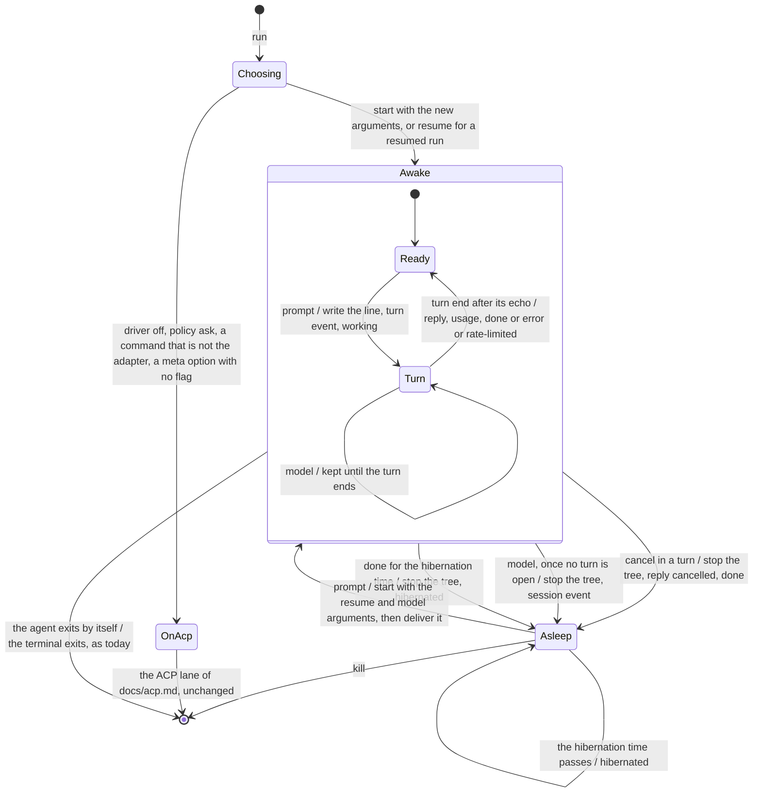

# Agent drivers: the lane core shed owns, and what a provider adds (#172)

## Summary

Decision: the bridge gets one driver interface. Everything that is not an agent's wire format moves into a lane core shed owns (history, the session list, resume, cancel, model, policy, usage, limits, hibernation, states). ACP becomes one driver; a second one runs an agent's own JSON-lines mode, with Claude as its first provider (a record plus one 130-line file). It is off until a host writes one line in its own `providers/claude.toml`. Anthropic's terms allow it and the three checks pass ([adr.md](adr.md)).
Slices: (1) split `acp.rs` into the lane core and the ACP driver, no behaviour change, +90; (2) shed's session index, history and resume for every driver, +95; (3) the stream driver with the test fake, +330; (4) the Claude provider, measured and smoke-tested live, +135. Total about +650 lines, so one cap raise from 12,612 to 12,850 (q2159) before slice 1.
Open questions, answered by the owner in q2159 (all three accepted as recommended): (1) drover and cooee pass shed their own adapter command, so "no drover or cooee change" needs the driver to keep their wrapper and swap only the adapter's part for `claude`: accept (recommended), or change both callers instead? (2) Policy `allow` becomes Claude's bypass mode, which drover's lane settings already ask for, with the lane's hook as the guard: accept (recommended), or auto mode with every prompt refused? (3) shed keeps a session's record and history 30 days after its last turn, and `shed rm` deletes them at once: accept (recommended)?

The question, the options, the terms and the three checks are in [adr.md](adr.md); the checks' script is
[check.py](check.py). This file has how it reads, the shapes, the boundaries, the statechart, the map from
Claude's lines to shed's events, and the slices.

## How it reads

The owner, on the one host that runs it first. Nothing else changes: not the `run` call, not drover, not
cooee.

```console
$ echo 'driver = "stream"' >> ~/.config/shed/providers/claude.toml
$ shed run --acp claude-acp --policy allow --name t1 --cwd /home/user/project   # as before
$ shed get t1 --json | jq -c '.session | {id, driver}'
{"id":"7e67b18c-4171-49cb-9292-3020bafedbab","driver":"stream"}
$ shed top t1                               # one `claude`, no `node`
$ shed cancel t1 && shed send t1 "go on"    # stops the agent; the send starts it on the same session
$ shed model t1 opus                        # takes effect with the next send, which starts it with --model
$ shed agents sessions claude-acp           # shed's own index, no agent started
7e67b18c-4171-49cb-9292-3020bafedbab  1795082531  /home/user/project  Fix the failing test
$ shed run --acp claude-acp --resume 7e67b18c-4171-49cb-9292-3020bafedbab   # history from shed's transcript
$ shed run --acp claude-acp --policy ask    # stays on the adapter; its first line says why
```

The lane core, `crates/shed-server/src/lane.rs`. One loop for every driver; today's `drive` and `run`
without the protocol:

```rust
loop {
    let (child, mut driver) = drivers::open(&chosen, &start, heard_tx.clone())?;
    match lane.awake(&mut driver, &mut heard, &mut inputs).await? {   // turns, watchdog, process tree
        Left::Exited => return Ok(child.wait().await?.code().unwrap_or(1)),
        Left::Stop(why) => {                    // Why::Idle | Why::Cancelled | Why::Model
            stop(child);                        // kill_tree, as hibernation today
            let Some(input) = lane.asleep(why, &mut inputs).await else { return Ok(0) };
            start = lane.wake(input);           // the resume arguments, the model, the input to deliver
        }
    }
}
```

Inside `awake`, an input asks the driver and the driver says whether its process must stop for it:

```rust
Input::Prompt(text) => { self.open_turn(&text); driver.prompt(&text)? }
Input::Cancel => if let Stop::Yes = driver.cancel()? {       // ACP: Stop::No, `session/cancel` is sent
    self.end_turn("cancelled", None, None);                  // reply, `done`
    return Ok(Left::Stop(Why::Cancelled));
},
Input::Model(model) => if let Stop::Yes = driver.model(&model)? {
    self.set_model(model);                                   // a `session` event
    if self.turns_open() { self.stop_after_turn() } else { return Ok(Left::Stop(Why::Model)) }
},
```

and everything an agent says arrives as one type, whatever the driver:

```rust
match heard {
    Heard::Text(text) => { self.reply.push_str(&text); self.emit(EventKind::Text { text }); self.check_login() }
    Heard::Tool(tool) => self.tool(tool),                    // titles, the open list, `running`
    Heard::Prompted => self.turn_taken(),
    Heard::TurnEnd { stop, error, tokens } if self.turn_is_taken() => self.end_turn(&stop, error, tokens),
    Heard::TurnEnd { .. } => {}                              // nobody's turn: a resumed agent tidying up
    Heard::Ask(ask) => self.ask(ask, driver),                // ACP only: the policy answers, or `waiting-approval`
    …
}
```

A provider's Rust file, whole, `crates/shed-server/src/providers/claude.rs` (about 130 lines with the
five small functions it calls):

```rust
#[derive(Default)]
pub(crate) struct Claude { mode: Option<String> }

impl Wire for Claude {
    fn prompt(&self, text: &str) -> String {
        json!({"type": "user", "message": {"role": "user", "content": [{"type": "text", "text": text}]}}).to_string()
    }

    fn heard(&mut self, line: &Value, record: &Stream) -> Vec<Heard> {
        let main = line["parent_tool_use_id"].is_null();
        match (line["type"].as_str(), line["subtype"].as_str()) {
            (Some("system"), Some("init")) => self.session(line),        // model, slash commands, mode
            (Some("user"), _) if line["isReplay"] == true => vec![Heard::Prompted],
            (Some("user"), _) => results(line),                          // tool_result: completed | failed
            (Some("stream_event"), _) if main => delta(&line["event"]),  // text_delta; a tool_use starts: pending
            (Some("assistant"), _) => calls(line, record),               // tool_use: in_progress, title, plan
            (Some("rate_limit_event"), _) => limit(line),                // status rejected
            (Some("result"), _) => end(line),                            // stop reason, error, tokens, usage
            _ => Vec::new(),
        }
    }

    fn mcp(&self, servers: &[Value]) -> String { … }                     // ACP's list as {"mcpServers": {…}}
}
```

The test fake needs no parser of its own. `crates/shed/tests/fake_stream.py` speaks the `plain` wire,
`providers/plain.rs` (20 lines): a prompt is `{"prompt": "…"}` and each stdout line is a `Heard` in JSON
(`{"text": "hi"}`, `{"turn_end": {"stop": "end_turn"}}`).

## Data shapes

### The provider record's new keys (`shed-proto`, `Provider`)

```rust
/// Which driver runs the agent's lanes: `acp` (the default) or `stream`.
pub driver: DriverKind,
/// The stream driver's data: the agent's own JSON-lines mode.
pub stream: Option<Stream>,

pub struct Stream {
    /// The provider's line format: `providers/<wire>.rs`.
    pub wire: String,
    /// The agent's command line, before the arguments of one start.
    pub command: Vec<String>,
    /// Text that names the ACP adapter when it is the last argument of a caller's own command.
    pub adapter: Option<String>,
    /// The words an adapter is started with (`npx`, `-y`, `node`); `command` replaces them and the adapter.
    pub launchers: Vec<String>,
    /// The arguments that start a session under the id shed made (`{session}`).
    pub new: Vec<String>,
    /// The arguments that start the agent on a session it has (`{session}`).
    pub resume: Vec<String>,
    /// The arguments that set the model (`{model}`).
    pub model: Vec<String>,
    /// The models `shed model` offers: id and name.
    pub models: Vec<[String; 2]>,
    /// The arguments that pass the MCP servers (`{file}`: a private file with `Wire::mcp`'s text).
    pub mcp: Vec<String>,
    /// Each policy's arguments; a policy without an entry stays on ACP.
    pub policy: BTreeMap<String, Vec<String>>,
    /// Each `--meta` option's flag, by its dotted path; an option without an entry stays on ACP.
    pub meta: BTreeMap<String, String>,
    /// Each tool's ACP kind and the input key that is its title.
    pub tools: BTreeMap<String, [String; 2]>,
    /// The tool, and its input key, whose list is the plan.
    pub plan: Option<[String; 2]>,
}
```

A user file overrides top-level keys, so `driver` is top-level: one line turns the built-in `[stream]`
table on. The built-in `providers/claude.toml` gains (and no `driver` key):

```toml
[stream]
wire = "claude"
command = ["claude", "-p", "--input-format", "stream-json", "--output-format", "stream-json",
           "--include-partial-messages", "--verbose", "--replay-user-messages"]
adapter = "claude-agent-acp"
launchers = ["npx", "-y", "node"]
new = ["--session-id", "{session}"]
resume = ["--resume", "{session}"]
model = ["--model", "{model}"]
models = [["opus", "Opus"], ["fable", "Fable"], ["sonnet", "Sonnet"], ["haiku", "Haiku"]]
mcp = ["--mcp-config", "{file}"]
plan = ["TodoWrite", "todos"]

[stream.policy]
allow = ["--permission-mode", "bypassPermissions", "--permission-prompts", "none"]
deny = ["--permission-mode", "default", "--permission-prompts", "none"]

[stream.meta]
"systemPrompt" = "--system-prompt"
"systemPrompt.append" = "--append-system-prompt"
"systemPrompt.excludeDynamicSections" = "--exclude-dynamic-system-prompt-sections"
"claudeCode.options.settingSources" = "--setting-sources"
"claudeCode.options.settings" = "--settings"
"claudeCode.options.strictMcpConfig" = "--strict-mcp-config"
"claudeCode.options.tools" = "--tools"
"claudeCode.options.allowedTools" = "--allowed-tools"
"claudeCode.options.disallowedTools" = "--disallowed-tools"
"claudeCode.options.model" = "--model"

[stream.tools]
Bash = ["execute", "command"]
Read = ["read", "file_path"]
Edit = ["edit", "file_path"]
Write = ["edit", "file_path"]
NotebookEdit = ["edit", "notebook_path"]
Grep = ["search", "pattern"]
Glob = ["search", "pattern"]
WebFetch = ["fetch", "url"]
WebSearch = ["fetch", "query"]
Task = ["think", "description"]
```

That table covers every option drover (`settingSources`, `settings`, `strictMcpConfig`) and cooee (those,
`tools`, `systemPrompt.append`, `systemPrompt.excludeDynamicSections`) pass today. A meta value becomes
arguments by its JSON type, in the driver, the same for every provider: a string or number is
`flag value`, `true` is `flag`, `false` and `null` are nothing, a list is `flag a,b,c`, an object is
`flag <its JSON>`. An object whose inner paths are in the table is walked instead.

One start's command line is `command + (new | resume) + model + policy[p] + mcp + meta flags`, with a
caller's wrapper in front. `choose` looks at the last argument of a caller's command only: when it holds
`adapter` and no white space, it and the `launchers` words right before it are replaced by `command`.
Anything else (another program, arguments after the adapter, the adapter named inside a script) stays on
ACP. drover's lane today, and the same lane on the driver:

```text
sh -c '<exports, settings copy> && exec "$@"' sh npx -y @agentclientprotocol/claude-agent-acp@0.101.0
sh -c '<exports, settings copy> && exec "$@"' sh claude -p … --session-id <id> --permission-mode bypassPermissions
     --permission-prompts none --setting-sources project,local --settings '{"claudeMdExcludes":[…]}' --strict-mcp-config
```

### What a driver hears (`lane`)

```rust
/// What an agent said, in shed's words. A driver makes these; the core turns them into events and states.
#[derive(Deserialize)]
#[serde(rename_all = "snake_case")]
pub(crate) enum Heard {
    /// The session is ready or changed; `None` leaves a part as it is.
    Session { model: Option<String>, models: Option<Vec<[String; 2]>>, commands: Option<Vec<[String; 3]>> },
    /// The agent took the prompt: the next `TurnEnd` is that turn's.
    Prompted,
    Text(String),
    Tool(Tool),
    Plan(Vec<Value>),
    Mode(String),
    Usage { used: u64, size: u64, cost: Option<Value> },
    /// The account's limit was hit, whatever the reply says.
    Limit { resets: Option<String> },
    /// ACP only: the agent asks to run a tool.
    Ask(Ask),
    TurnEnd { stop: String, error: Option<String>, tokens: Option<Tokens> },
    /// A line the driver could not read: one dim line in the preview.
    Skipped(String),
}

/// A tool call's id and what changed about it.
pub(crate) struct Tool {
    pub id: String,
    pub title: Option<String>,
    pub kind: Option<String>,
    pub status: Option<String>,
    pub locations: Vec<PathBuf>,
    pub raw_input: Option<Value>,
}

/// A permission request, as `approval_request` reports it.
pub(crate) struct Ask { pub id: String, pub tool: String, pub options: Vec<ApprovalOption>, pub call: Option<Value> }

pub(crate) trait Driver {
    fn prompt(&mut self, text: &str) -> Result<(), String>;
    fn cancel(&mut self) -> Result<Stop, String>;
    fn model(&mut self, model: &str) -> Result<Stop, String>;
    /// ACP only; the default says no permission request is waiting.
    fn approve(&mut self, option: &str, request: Option<&str>) -> Result<Option<String>, String>;
}

/// Whether the agent's process must stop for it; the next send starts it again on the same session.
pub(crate) enum Stop { No, Yes }

/// What one start of the agent needs; `resumed` picks the record's `resume` arguments over `new`.
pub(crate) struct Start { pub session: String, pub resumed: bool, pub model: Option<String>, pub deliver: Option<Input> }
```

`Wire` is the three functions in the Claude file above. It is defined in `drivers/stream.rs`, with the one
helper a provider file may call: `Stream::tool(name, input)`, which applies the record's `tools` table.

### shed's session index

One record and one transcript per session, beside the state file, written by the lane's writer (0600, the
folder 0700), for every driver:

```text
sessions/<id>.json     the record below, rewritten (temp file, rename) when the session starts and at each turn's end
sessions/<id>.jsonl    the transcript: the events `read` renders. `acp/<name>.jsonl` today
sessions/<id>.mcp.json stream driver only, while the agent starts: the MCP servers, values included
```

```rust
/// A session shed ran: `agents sessions` lists these, `run --resume <id>` continues one.
pub struct SessionRecord {
    /// The agent's session id. On the stream driver shed makes it (a UUID from `/dev/urandom`, no new crate).
    pub id: String,
    /// The agent id of `run --acp`.
    pub agent: String,
    /// The folder it ran in.
    pub cwd: PathBuf,
    /// The first prompt's first line, at most 80 characters.
    pub title: String,
    /// When its last turn ended, else when it started, unix seconds.
    pub updated: u64,
    /// How many turns it has had.
    pub turns: u64,
    /// The transcript's path; filled in by `agents sessions`, not stored.
    pub transcript: Option<PathBuf>,
}
```

- An id is a file name only as `[A-Za-z0-9._-]+`; any other byte is written `%XX`, since an ACP agent
  chooses its own ids.
- `run --resume <id>`: the writer opens `sessions/<id>.jsonl` to append, sends its events to the server
  marked `"replay": true` and draws them, then the driver loads the session at the agent (`session/load`,
  or the `resume` arguments). What an ACP agent replays during the load is dropped, as on a wake today.
- **A session shed never ran** has no files: it resumes, with no earlier history shown, gets its record
  at that moment and is listed from then on. `agents sessions` lists shed's own sessions only.
- `shed rm` of a lane's terminal deletes its session's files (and, on ACP, still sends `session/close`).
  The server's prune pass deletes sessions idle longer than `$SHED_SESSIONS_KEEP` days (default 30). A
  terminal's own prune no longer takes the transcript with it.
- `AcpSession` gains `driver` (`acp` or `stream`); `read` finds a terminal's transcript by `session.id`.
  Both new protocol shapes are additions, and the two protocol docs regenerate (`just generate`).

## Module boundaries

| module | owns | may call |
|---|---|---|
| `lane` (`lane.rs`: the core; `lane/transcript.rs`: `render`, `Preview`; `lane/writer.rs`: `Writer`, the PTY input and lending; `lane/sessions.rs`: the index) | `Input`, `frame`, the turn and state machine, the watchdog, the process tree, limit and login rules, token sums, hibernation, the wake loop, `Heard`, `Driver`, `Start` | `drivers::open` and `drivers::choose`; `shed_core::{runner, proctree, clock}`; `handover`, `config`, `providers::find`. No protocol crate, no agent's name |
| `drivers/acp.rs` | the ACP SDK: handshake, `session/new` and `session/load`, updates and permission requests into `Heard`, `session/cancel`, the model option, `close` for `rm` | `lane`'s `Heard`, `Driver`, `Start`. The only file that imports `agent_client_protocol` |
| `drivers/stream.rs` | `Wire`, the command line of one start (wrapper, placeholders, meta flags), the MCP file, the agent's stdin and stdout, `choose` | `providers::wire`, `shed_core::runner::piped`, `lane`'s three types |
| `providers.rs`, `providers/<name>.toml`, `providers/<name>.rs` | records; one `Wire` per file, collected by `build.rs` | `drivers::stream::{Wire, Stream}`, `lane::Heard`, `serde_json`. No process, file, clock or environment |
| `registry.rs`, `lib.rs` | as today | `lane::{frame, Input, LANE_STATES, transcript, sessions}`, `drivers::choose` (in `bridge`), `drivers::acp::close` (in `rm`) |
| `shed` (CLI) | as today | `shed_server::lane::{bridge, Input, frame, Preview, stdout_style, sessions::list}`; `shed_server::acp` is gone |

- `drivers::choose(record, policy, cmd, installed, meta)` is one pure function, called once by the server
  in `run`: it returns the driver and the agent's command (the caller's wrapper kept), or the reason the
  lane stays on ACP. `run` still refuses at once when it must be ACP and no adapter is installed. The
  bridge is told the driver and the reason as arguments and trusts them.
- A driver never emits an event, reports a state, touches the transcript or reads a provider pattern. The
  core never sees a protocol message.
- The names clients know stay: `run --acp`, the `acp` field, `shed acp-bridge`, the `acp.model` method.

## Statechart: a lane on the stream driver



- `Asleep` is one state with three ways in, and it is today's hibernation: only the bridge is left. What
  the lane reports there is what it last reported (`done` with `cancelled`, `done`, `idle`) until the
  hibernation time has passed, then `hibernated`.
- A wake uses `resume` once the session has had a turn end. Before that, a start with `resume` that exits
  at once is tried once more with `new`: Claude has no file for a session stopped before its first prompt
  was saved (checked).
- A turn's end counts only after `Prompted`; a `result` before it ends nothing (checked: a resumed
  process tidying a background command prints one). Prompts sent during a turn are written at once and
  Claude runs them in order, each with its own echo and `result` (checked); a cancel ends them all, as
  `session/cancel` does on ACP.
- The watchdog, `running` for a live child process, `rate-limited` and the login check are the core's and
  work as in `docs/acp.md`. `waiting-approval` cannot happen here.

## From Claude's lines to shed's events

Every state and event of `docs/acp.md`, with its source on each driver. **Differs** marks what a client
of a stream lane sees differently; **lost** what it does not get.

| shed reports | on ACP today | on the stream driver | for a client |
|---|---|---|---|
| `session.id` | `session/new` | made by shed, passed as `--session-id`; `init.session_id` equals it | same; known before the first prompt |
| `session.model` | the model config option | `init.model`; before the first turn, what `shed model` set | **differs**: empty until the first turn |
| `session.models` | the option's choices | the record's `models` | **differs**: the record's list; `shed model` passes any name on, and a wrong one fails the next turn |
| `session.commands` | `available_commands_update` | `init.slash_commands` | **differs**: names only, no description or hint, and from the first turn |
| `session.mcp_servers`, `cache_lifetime`, `turn_ended`, `cache_likely` | shed | shed | same |
| `session.ready_ms` | `run` to the `session/new` reply | `run` to the process started | **differs**: the agent's own start is in `first_token_ms` instead (0006: 584 ms) |
| `session.first_token_ms` | first prompt to first text | the same | same |
| `session.driver` | new: `acp` | new: `stream` | new |
| `started`, `state`, `exited`, `resources`, `mem-limit` | the terminal's | the terminal's | same |
| `turn` | shed, on send | shed, on send | same |
| `text` | `agent_message_chunk` | `stream_event` `text_delta` of the main conversation | same |
| `tool_call` | `tool_call`, `tool_call_update` | `pending`: `content_block_start` of a `tool_use`; `in_progress`: the `assistant` line's `tool_use` (its `input` is `raw_input`, up to 4 KiB); `completed` or `failed`: the `user` line's `tool_result` (`is_error`) | **differs**: the title is the command, path or query (the record's `tools`), else the tool's name; `locations` is that path, without lines |
| `plan` | `plan` | the `TodoWrite` call's `todos` | **differs**: entries have `content` and `status`, no `priority` |
| `mode` | `current_mode_update` | `init.permissionMode` when it is not the last one seen | **differs**: seen when the next turn starts |
| `approval_request`, `approved` | each permission request, and the policy's answer | none | **lost**: the flags decide inside Claude; answering needs the control protocol. A refused call is a `tool_call` `failed` |
| `reply` | the prompt's stop reason | `result.stop_reason`; `cancelled` from shed; `auth_error` by the record's pattern, as today | same; the text is the turn's text chunks, as today |
| `usage` (`used`, `size`, `cost`) | `usage_update`, during the turn | at the turn's end: the last request's input and cache tokens, `modelUsage.<model>.contextWindow`, `total_cost_usd` | **differs**: once per turn |
| `usage.turn`, `usage.total` | `_meta.quota` (`[quota]`) | `result.usage`: `input_tokens`, `cache_read_input_tokens`, `cache_creation_input_tokens`, `output_tokens`; shed sums | same |
| state `working` | a turn is open | the same | same |
| state `running` | an open tool call; a live child after the turn | the same, from the lines above and the process tree | same |
| state `waiting-approval` | a permission request under `ask` | never | **lost** here; a lane with policy `ask` is on ACP |
| state `rate-limited` | the limit pattern in the reply or error | the same pattern on the reply and `result`, and `rate_limit_event` with `status` `rejected` | same; a gain: it no longer hangs on the wording alone |
| state `done` | a clean stop reason | a `result` without `is_error`; the note is the stop reason | same |
| state `error` | an agent error, exit, the watchdog | `result.is_error` (the note is its text, `auth: …` by the pattern), exit, the watchdog | same |
| state `hibernated` | shed | shed | same |
| the turn watchdog | any message or stderr line | any stdout line (`stream_event`, `system/status`, `thinking_tokens`, `api_retry`) or stderr line | same |
| `shed cancel` | `session/cancel` | the process is stopped; the next send resumes | **differs**: background commands the turn started end too, and the next send pays a wake |
| `shed model` | `session/set_config_option`, at once | kept for the next start, which gets `--model` | **differs**: asked in a turn, it waits for the turn's end |
| `run --resume`, the replay | the agent's `session/load` replay | shed's transcript | **differs** on both drivers: a session shed never ran shows no history |
| `shed agents sessions` | `session/list` | shed's index | **differs** on both drivers: shed's sessions only, shed's JSON shape, no agent needed |
| `shed rm` | `session/close` | shed's files go; Claude's own session file stays until Claude cleans it | same |
| `--mcp` | in `session/new`, memory only | `--mcp-config <file>`; `http` and `sse` always taken | **differs**: the values are in a 0600 file while the agent starts |
| `--meta` | sent as `_meta` | mapped to flags by the record | same, or the lane is on ACP |
| `--warm`, `--no-hibernate`, the prompt cache fields, the process tree, the memory limit | shed | shed | same |

Claude's other lines (`system/status`, `hook_*`, `task_*`, `compact_boundary`, thinking, a subagent's
text) are heard by the watchdog and otherwise ignored, as the adapter's thought chunks are today.

## Slices

Each is its own issue and PR, in this order; lines are non-test lines under `crates/*/src`.

| | slice | what | lines |
|---|---|---|---|
| 1 | **Split, no behaviour change** (queue `--refactor`) | `acp.rs` becomes `lane.rs`, `lane/transcript.rs`, `lane/writer.rs` and `drivers/acp.rs`; `Session` splits into the core's `Lane` and the ACP driver; `Heard`, `Driver`, `Start`; the CLI and registry use `lane::`. Tests move with their code | +90 |
| 2 | **shed owns sessions** | `lane/sessions.rs`; transcripts by session id; replay from shed's transcript; `agents sessions` from the index; `rm` and the prune pass; `SessionRecord` and `session.driver` in the protocol. Goes: the agent replay parsing, `acp::sessions`, the transcript's move on a warm take | +95 |
| 3 | **The stream driver and the fake** | `Stream` and `driver` in the record; `drivers/stream.rs`; `choose` in `run`; `Stop` handling and `Asleep` in the core; `providers/plain.rs`; `build.rs` collects `providers/*.rs`; `tests/fake_stream.py` and `tests/stream.rs` (a turn, a tool, cancel then resume, model, hibernate and wake, `ask` and an unmapped meta option staying on ACP, a wrapper kept, the MCP file) | +330 |
| 4 | **Claude** | `providers/claude.rs`, the `[stream]` table, `docs/acp.md`; `scripts/measure-claude-direct.py` gains a fourth mode, a real `shed` lane on the driver; the live smoke | +135 |

Total about +650 on 12,098, against a cap of 12,612: **one raise to 12,850** (q2159), filed by the orchestrator
before slice 1 (650 plus about 100 of margin). 0006 guessed +500 to 800 for a Claude-only module; this is
in that range, but 130 lines of it are Claude's and the next provider is a record and about that many
lines again.

Acceptance of the build, on slice 4:

- An awake Claude lane on the driver, measured with `scripts/measure-claude-direct.py`'s method (the
  process tree's RSS 2 s after the first turn ends, median of 3), is **at least 100 MB under the adapter
  run with `node`** on the same machine and day. 0006 measured 114 MB.
- The live smoke, through `shed` with drover's lane command and `--meta`: drover's hook blocks a call
  under policy `allow`; `shed cancel` mid tool call, then `shed send`, answers on the same session id;
  `shed top`'s `CACHE` on the turn after a hibernation is over 80%; a lane run with `--policy ask` shows
  `session.driver` `acp`.
- No state or event of the map above is missing or different beyond what the map marks.
