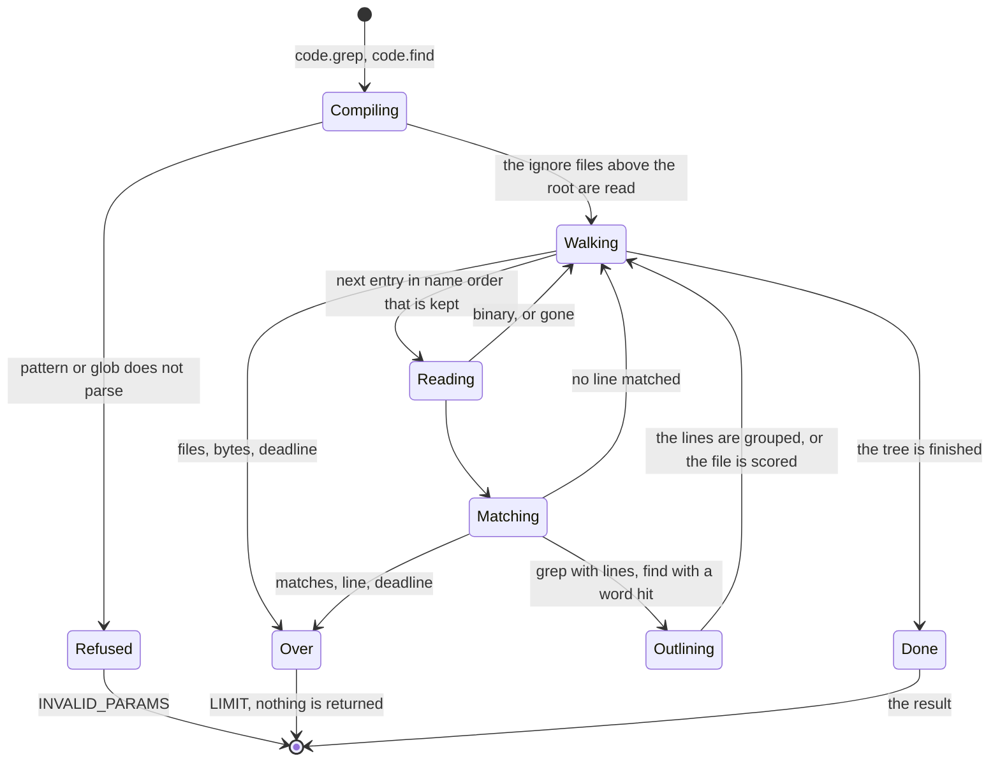

# Code search: `code.grep`, `code.find`, `code.outline` (#193)

## Summary

Decision: shed gets its own code search in two small crates with no outside dependency. One is today's pattern matcher, moved out of the core and given groups, alternation and counts on an engine that cannot blow up on a hostile pattern. The other walks a tree by its ignore files, finds lines by their fixed text first, and outlines Rust, TypeScript/JavaScript, Python, Markdown and TOML by the shape of their lines. Grep answers are grouped under the function or type that holds each line, find ranks files with reasons, and six fixed limits are errors that name the limit. A measured prototype finds the same lines as rg on eleven queries, at single-threaded rg's speed whenever the pattern holds fixed text.
Slices: (1) the pattern crate, also behind wait-for-output, +380; (2) outlines and the outline method, +690; (3) the walk and grouped grep, +690; (4) find, +250. About +2,010 source lines in all.
Open questions: (1) the script design (#192) moves the matcher into the API-types crate, this one gives it a crate of its own that the script crate may then use: own crate (recommended), or the API-types crate? (2) wait-for-output takes the new syntax too, so brackets and the bar in a caller's existing pattern become operators: accept (recommended), or keep the old syntax there? (3) One cap raise of 2,200 before slice 1, on top of whatever #192 gets (recommended), or one per slice? (4) Let the file-read method take a line range, +15 lines in slice 2, so a caller on another machine can read just the span a result names: add (recommended), or leave it out?

The question, the options, the benchmark and the consequences: [adr.md](adr.md). Measured with
[bench/prototype.rs](bench/prototype.rs), a throwaway that is not product code (it indexes, unwraps and prints).

## How it reads

### From a terminal

The results below are the prototype's, on shed at `ce4424e`; the error line is the designed one.

```console
$ shed code grep -w is_match
crates/shed-core/src/pattern.rs
  impl Pattern > fn is_match [107-115]
    109:     pub fn is_match(&self, text: &str) -> bool {
  mod tests > fn m [136-138]
    137:         Pattern::new(re).expect("valid pattern").is_match(text)
crates/shed-server/src/lib.rs
  fn wait [848-916]
    890:                         .is_some_and(|re| t.screen().lines().any(|l| re.is_match(l)))
3 matches in 2 files, 243 files searched

$ shed code outline crates/shed-core/src/pattern.rs
crates/shed-core/src/pattern.rs (rust, 161 lines, 13 symbols)
  enum Atom [8-13]
  impl Atom [15-25]
    fn matches [16-24]
  struct Pattern [27-33]
  fn escape [35-43]
  impl Pattern [45-130]
    fn new [46-105]
    fn is_match [107-115]
    fn at [117-129]
  mod tests [132-161]
    fn m [136-138]
    fn matches_the_supported_subset [140-153]
    fn rejects_broken_patterns [155-160]

$ shed code find 'wait output pattern' --top 2
1. crates/shed-core/src/pattern.rs (rust, 161 lines)
     why: name is pattern; lines: wait 1, output 1, pattern 10
     struct Pattern [27-33]
     impl Pattern [45-130]
     fn rejects_broken_patterns [155-160]
2. crates/shed-server/src/lib.rs (rust, 1166 lines)
     why: lines: wait 89, output 6, pattern 4
     fn wait [848-916]
     fn wait_children [918-971]
2 of 94 files, 243 searched

$ shed code grep -F self
shed: LIMIT: matches over 250 at crates/shed-core/src/history.rs; narrow the path, add a glob, or ask for a count
$ shed code grep -F self --count --glob '*.rs' crates/shed-core
src/history.rs: 21
src/keys.rs: 1
src/pattern.rs: 8
…
318 matches in 7 files, 12 files searched

$ shed --on host-a code grep 'fn \w+_limit' /srv/lanes/issue-12 --glob '*.rs' --glob '!tests/'
```

`shed code grep [-F] [-i] [-w] [--count] [--hidden] [--glob G]… PATTERN [PATH]`,
`shed code find [--top N] [--hidden] [--glob G]… 'WORDS' [PATH]`, `shed code outline FILE`. `PATH` defaults
to the current folder and may be one file. `--json` and `--on` are the global flags every command has; with
`--on` the path is absolute on that machine, as `exec --cwd` is.

A span is then read with the caller's own reader, or over a link with `shed file read --lines 107-115`
(open question 4).

### From the server

```rust
// crates/shed-server/src/code.rs: the one server file that names shed_search
pub(crate) async fn grep(p: GrepParams) -> Result<Value, RpcError> {
    let expired = deadline(search::LIMITS.deadline);      // a closure over shed_core::clock
    let done = blocking(move || search::grep(&p, &search::LIMITS, &expired)).await?;
    json(&done.map_err(refusal)?)
}

fn refusal(e: search::Error) -> RpcError {
    match e {
        search::Error::Query(why) => RpcError::new(ErrorCode::InvalidParams, why),
        search::Error::Limit(over) => RpcError::new(ErrorCode::Limit, over),
        search::Error::Io(why) => RpcError::new(ErrorCode::Io, why),
    }
}
```

The three methods join `exec` and `file.read` in the two places that route by `machine`: the `"machine"`
arm of `links::remote` and the `here` list of `linked`. A script (#192) reaches them through the same
`dispatch` as a socket request. They read any file the server's user can, so in a script they take
whatever class `file.read` gets there (#192's open question 2).

```rust
// crates/shed/src/code.rs
let found: GrepResult = server.connect(None)?.call(Method::CodeGrep, &args.params(server)?)?;
print(json, &found, || search::text::grep(&found))        // shed_server::search re-exports the crate
```

```rust
// crates/shed-server/src/lib.rs, wait --output: one import changes
use shed_pattern::Pattern;
```

### The two crates

```rust
// shed-pattern: std only
impl Pattern {
    pub fn new(re: &str) -> Result<Self, Error>;                  // wait --output
    pub fn with(re: &str, flags: Flags) -> Result<Self, Error>;   // Flags { ignore_case, word, fixed }
    pub fn is_match(&self, text: &str) -> bool;                   // one line; linear in its length
    pub fn needles(&self) -> &[String];   // every match holds one of these; empty when none is known
}

// shed-search: shed-pattern and shed-proto's types
pub fn grep(p: &GrepParams, limits: &Limits, expired: &dyn Fn() -> bool) -> Result<GrepResult, Error>;
pub fn find(p: &FindParams, limits: &Limits, expired: &dyn Fn() -> bool) -> Result<FindResult, Error>;
pub fn outline(p: &OutlineParams, limits: &Limits) -> Result<OutlineResult, Error>;
pub const LIMITS: Limits;
pub mod lang { pub fn outline(lang: Lang, text: &str) -> Vec<Symbol>; }   // pure: text in, symbols out
pub mod text { pub fn grep(r: &GrepResult) -> String; /* find, outline */ }
```

## Data shapes

In `crates/shed-proto/src/code.rs`, re-exported at the crate root, so `docs/protocol.md` and the OpenRPC
document describe them like every other method (`just generate`).

```rust
pub struct GrepParams {
    pub root: PathBuf,          // a folder or one file; relative to the server's folder, as exec's cwd
    pub pattern: String,        // shed's pattern syntax; `fixed` takes it as plain text
    pub fixed: bool,
    pub ignore_case: bool,
    pub word: bool,             // the match must start and end at a word boundary
    pub count: bool,            // per-file counts only: no lines, no outline
    pub hidden: bool,           // also dot files and dot folders (never `.git`)
    pub glob: Vec<String>,      // `*.rs` keeps, `!tests/` drops
    pub machine: Option<String>,
}
pub struct GrepResult { pub files: Vec<FileMatches>, pub matches: usize, pub searched: usize }
pub struct FileMatches { pub path: String, pub lang: Lang, pub count: usize, pub groups: Vec<Group> }
pub struct Group { pub scope: Vec<Symbol>, pub lines: Vec<Line> }   // scope: outermost first; empty = top level
pub struct Line { pub n: usize, pub text: String }                  // 1-based; the line as it is in the file

pub struct Symbol { pub kind: Kind, pub name: String, pub start: usize, pub end: usize, pub depth: usize }
pub enum Kind { Fn, Struct, Enum, Trait, Impl, Mod, Const, Type, Macro, Class, Interface, Section, Block }
pub enum Lang { Rust, Typescript, Javascript, Python, Markdown, Toml, Text }

pub struct OutlineParams { pub path: PathBuf, pub machine: Option<String> }
pub struct OutlineResult { pub path: String, pub lang: Lang, pub lines: usize, pub symbols: Vec<Symbol> }

pub struct FindParams {
    pub root: PathBuf,
    pub query: String,          // words; a file is ranked by how many of them it answers, and where
    pub top: Option<usize>,     // default 10, at most 50
    pub hidden: bool,
    pub glob: Vec<String>,
    pub machine: Option<String>,
}
pub struct FindResult { pub files: Vec<Found>, pub total: usize, pub searched: usize }
pub struct Found {
    pub path: String, pub lang: Lang, pub lines: usize, pub score: u32,
    pub why: Vec<String>,       // "name is pattern", "path has lane", "lines: wait 89, output 6", "a test"
    pub symbols: Vec<Symbol>,   // at most 5 whose name holds a word, exact names first
}
```

Paths in results are relative to `root`, with `/`. `start` and `end` are 1-based and inclusive; `start` is
the first comment, attribute or decorator line directly above the header. `find` is the one place a list is
shortened, and it says so: `files.len()` of `total`.

`code.grep` on `pattern.rs` alone, `--json` (the full file: [grep-retries-rs.json](../../../crates/shed-search/tests/golden/grep-retries-rs.json)):

```json
{"files": [{"path": "crates/shed-core/src/pattern.rs", "lang": "rust", "count": 2, "groups": [
   {"scope": [{"kind": "impl", "name": "Pattern", "start": 45, "end": 130, "depth": 0},
              {"kind": "fn", "name": "is_match", "start": 107, "end": 115, "depth": 1}],
    "lines": [{"n": 109, "text": "    pub fn is_match(&self, text: &str) -> bool {"}]},
   {"scope": [{"kind": "mod", "name": "tests", "start": 132, "end": 161, "depth": 0},
              {"kind": "fn", "name": "m", "start": 136, "end": 138, "depth": 1}],
    "lines": [{"n": 137, "text": "        Pattern::new(re).expect(\"valid pattern\").is_match(text)"}]}]}],
 "matches": 2, "searched": 1}
```

### Limits and errors

```rust
pub struct Limits { files: usize, matches: usize, symbols: usize, bytes: u64, line: usize, deadline: Duration }
pub enum Error { Query(String), Limit(Over), Io(String) }
pub struct Over { pub limit: Limit, pub max: u64, pub at: String }   // Display: "matches over 250 at <path>; narrow …"
pub enum Limit { Files, Matches, Symbols, Bytes, Line, Deadline }
```

| limit | fixed at | what it counts |
|---|---|---|
| `files` | 20,000 | files read, after the ignore rules and globs |
| `matches` | 250 | rows in a grep result: matched lines, or files with `count` |
| `symbols` | 2,000 | symbols in one outline |
| `bytes` | 256 MiB | bytes of the files read, by their size, before each read |
| `line` | 4,096 bytes | the length of a matched line in the result (shed's longest line today is 2,869) |
| `deadline` | 10 s | wall time, asked before each folder, each file and every 1,024 lines |

Going over any of them is the error `LIMIT` (a new code, -32011) and no result:
`LIMIT: line over 4096 at web/app.min.js:1; narrow the path, add a glob, or ask for a count`. The values are
constants in one `Limits`; the tests pass their own small ones.

| the crate says | the socket answers |
|---|---|
| `Query`: a pattern or glob that does not parse, an empty pattern, no words | `INVALID_PARAMS: pattern "a(?=b)": only (?:…) groups; no lookaround, flags or names` |
| `Limit` | `LIMIT: …` |
| `Io`: the root is missing, or a file cannot be read | `IO: /srv/lanes/x: No such file or directory` |

A file that is gone between its listing and its read is skipped; that is not a cut, the file is not there.

## Module boundaries

```text
shed (cli) ──► shed-server ──► shed-core
                  │   │
                  │   └──────► shed-proto ◄──┐
                  ├──────────► shed-search ──┤
                  └──────────► shed-pattern ◄┘ (from shed-search)
```

| module | does | may call |
|---|---|---|
| `shed-pattern` | parse a pattern, compile it, match one line, name its needles | std |
| `shed-search::walk` | list a tree in name order and read its files: hidden, symlinks, binary, the byte and file limits. The one file in the crate that names `std::fs` | `ignore` |
| `shed-search::ignore` | `.gitignore` rules and globs | nothing |
| `shed-search::needle` | fixed-text search over bytes (Horspool), any ASCII case | nothing |
| `shed-search::matcher` | a query to the matched lines of one file | `needle`, `shed-pattern` |
| `shed-search::lang` | `Lang::of(path)`, the shared range rule, one file per language under `lang/` | nothing |
| `shed-search::{grep, find, outline}` | the three entry points | `walk`, `matcher`, `lang` |
| `shed-search::text` | a result as plain text | the proto types |
| `shed-proto::code` | the params and results | nothing |
| `shed-server::code` | params in, `spawn_blocking`, the deadline closure, errors out | `shed-search` |
| `shed::code` | the `code` subcommands | `shed-server` (its `search` re-export for `text`) |

`shed-search` and `shed-pattern` never use `shed-core` or `shed-server`, start no process, read no clock and
no environment, and write nothing. `.drover/arch.toml` holds that (the ADR ends with the lines); their
`Cargo.toml` files hold the rest, since neither depends on tokio.

## One query's run



`code.outline` is `Reading` and `Outlining` for one file. Nothing is kept between requests. The outline
scanner itself has two states per line, plain and skipped: inside a Markdown code fence, inside a Python
`"""` string.

## Walking

| read | not read |
|---|---|
| `.gitignore` in the root and in every folder walked | the user's global ignore file |
| the `.gitignore` of each folder above the root, up to the repository's top | `.ignore`, `.rgignore` |
| `info/exclude` of the git folder, found through a worktree's `.git` file and its `commondir` | `core.ignoreCase` |

- Syntax: blank lines, `#`, `\#` and `\!`, `!` to keep again, a trailing `/` for folders only, a leading or
  inner `/` to anchor at the file's folder, `*`, `?`, `[a-z]`, `[!a]`, and `**` as a whole segment.
- The last rule that matches wins; a deeper file beats a shallower one and `info/exclude` is weakest. An
  ignored folder is never entered, so nothing inside it can be kept again (git's own rule).
- Never `.git`. Names starting with `.` only with `hidden`. No symlink is followed, to a file or a folder.
  A file with a NUL byte in its first 8 KiB is binary and skipped.
- The root is searched even when a rule above would ignore it.
- `glob` uses the same syntax: with any plain glob a file must match one; a `!` glob drops files and prunes
  folders.

## Patterns

| | construct |
|---|---|
| as today | literals, `.`, `[a-z_]`, `[^…]`, `\d \w \s`, `\` escapes, `*`, `+`, `?`, `^` first, `$` last |
| new | `( … )`, `(?: … )`, `a\|b`, a quantifier on a group, `{n}` `{n,}` `{n,m}` up to 1,000, `\b`, `\D \W \S`, `\n \t`, `\d` inside `[…]`, lazy `*?` `+?` `??` (same answer for a yes or no match) |
| changed | `^` and `$` are anchors anywhere (they were plain characters except first and last); `(`, `)` and `\|` are operators (they were plain characters); `{` stays plain unless a count follows |
| refused, by name | backreferences, lookaround, inline flags, named groups, a compiled pattern over 4,000 steps |

A query is a pattern unless `fixed`. Its needles are the fixed text every match must hold: the longest run
of plain characters, or one per branch of a top-level alternation. The file is scanned for the needles as
bytes and the engine runs only on the lines that hold one; a pattern with no needle runs on every line. A
pattern that is only plain characters never reaches the engine.

## Outlines

A header line names a symbol; one shared rule gives its range.

| language | by extension | headers |
|---|---|---|
| Rust | `rs` | `fn`, `struct`, `union`, `enum`, `trait`, `impl` (named `Trait for Type`), `mod x {`, `const`, `static`, `type`, `macro_rules!`, after `pub`, `pub(…)`, `async`, `unsafe`, `const`, `extern "…"` |
| TypeScript, JavaScript | `ts tsx mts cts js jsx mjs cjs` | `function`, `class`, `interface`, `type X =`, `enum`, `namespace`, `const x = (…) =>` as `fn`, any other top-level `const` as `const`, after `export`, `default`, `declare`, `abstract`, `async`; in a class body, `name(` and `name = (…) =>` at the members' indentation |
| Python | `py pyi` | `def`, `async def`, `class` |
| Markdown | `md markdown` | `#` to `######` outside code fences; a section runs to the next heading of its level or above |
| TOML | `toml` | `[table]` and `[[array]]`, to the next one |
| anything else | | a line at column 0 followed by deeper lines, named by its text (80 characters at most), kind `block` |

The range rule, for all but Markdown and TOML:

1. The range starts at the comment, attribute or decorator lines directly above the header.
2. A header that ends with `;`, or holds `{` and ends with `}`, is one line.
3. Otherwise deeper-indented lines belong to it. At the header's indentation or less:
   - a line that starts with a closing bracket and ends with an opening one goes on (`) -> T {`);
   - a line that starts with a closing bracket ends it there, unless `where` or a lone `{` follows
     (`) -> T` over a `where` clause);
   - `{` alone, or `where` before the body, goes on;
   - any other line is skipped once the header has opened a bracket (a raw string at column 0); before
     that the symbol ended on the last line above (`type A =` over an indented second line).
   - Python has no closing line: the block ends before the next line at its indentation or less. A `#`
     line there does not end it, and lines inside `"""` are skipped.
4. Symbols nest only inside `impl`, `trait`, `mod` and `class`. A function is a leaf.

On shed's own 68 Rust files the rule gives 1,519 symbols. [bench/check-outline.py](bench/check-outline.py)
compares each range's end with a bracket-matching lexer: 1,518 agree, and the odd one is the lexer's miss (a
`const` whose value is an `if`/`else`). The check found three wrong ends first, all a `) -> T` line over a
`where` clause; the rule above and `sample.rs` now hold that case. The three `fn` lines the outline leaves
out are functions inside functions. Rust is the only language with a corpus in this repo: the other
languages rest on their goldens until a lane's repo gives one. Known misses, each to be pinned by a golden:
a line that looks like a header inside a multi-line string, items a macro writes, Setext headings, mixed
tabs and spaces.

### Goldens

The outline inputs are in [crates/shed-search/tests/golden/](../../../crates/shed-search/tests/golden/),
named `sample.<ext>.in` so `just comments` does not read the Rust one as source; each `.outline` beside them
is the text outline, and the crate's test globs them as `lang::outline` on the text. The grep goldens
(`grep-retries.*`) and the find golden (`find-queue-retries.txt`, `--top 3`) are beside them and run on a
temp copy without the `.in`.

<table><tr><td>

```text
sample.rs (rust, 74 lines, 16 symbols)
  const RETRIES [3-4]
  type Outcome [6-7]
  struct Job [9-14]
  enum QueueError [16-19]
  trait Queue [21-24]
    fn push [22-22]
    fn len [23-23]
  impl fmt::Display for Wrapper<T> [28-35]
    fn fmt [32-34]
  impl Job [37-49]
    fn run [38-44]
    fn fresh [46-48]
  fn drain [51-58]
  macro job [60-64]
  mod tests [66-74]
    fn fresh_has_no_retries [70-73]
```

</td><td>

```text
sample.ts (typescript, 59 lines, 13 symbols)
  const RETRIES [3-4]
  interface Job [6-9]
  type Outcome [11-13]
  enum State [15-18]
  class Queue [22-49]
    fn constructor [25-27]
    fn push [29-35]
    fn drain [37-42]
    fn size [44-46]
    fn retry [48-48]
  fn runAll [51-53]
  fn fresh [55-55]
  fn main [57-59]
```

</td></tr><tr><td>

```text
sample.py (python, 50 lines, 8 symbols)
  class QueueError [10-11]
  class Queue [14-39]
    fn __init__ [18-20]
    fn size [22-24]
    fn push [26-33]
    fn drain [35-39]
  fn fresh [42-42]
  fn main [45-50]
```

</td><td>

```text
sample.md (markdown, 22 lines, 4 symbols)
  section Job queue [1-22]
    section Retries [5-16]
      section Backoff [14-16]
    section Limits [18-22]
sample.toml (toml, 13 lines, 3 symbols)
  section limits [4-6]
  section limits.backoff [8-10]
  section notify [12-13]
sample.go (text, 27 lines, 3 symbols)
  block type Queue struct [10-13]
  block func (q *Queue) Push(job Job) error [15-21]
  block func retries [23-27]
```

</td></tr></table>

What each one pins: Rust, a `where` clause after an `impl` and after a signature, a signature over four lines, a two-line `type`, a doc comment
and `#[derive]` joined to their item, a `// fn` comment that is no symbol; TypeScript, class members, an
arrow property, a getter, a union type over three lines; Python, a module docstring holding `def`, a
decorator, a one-line `def`, a nested `def` left out, a comment at column 0 inside a body; Markdown, a `#`
inside a fence and `#hashtag`; Go, the fallback.

`shed code grep -w retries` over the six samples ([grep-retries.txt](../../../crates/shed-search/tests/golden/grep-retries.txt)), in
part:

```text
sample.go
…
sample.md
  section Job queue > section Retries [5-16]
    11: queue retries --max 3
sample.py
  class Queue > fn push [26-33]
    29:         retries=RETRIES,
    32:             raise QueueError(f"full after {retries} retries")
  fn fresh [42-42]
    42: def fresh(job_id): return {"id": job_id, "retries": 0}
sample.rs
  struct Job [9-14]
    13:     pub retries: usize,
  enum QueueError [16-19]
    18:     Closed { retries: usize },
  (top level)
    26: // fn old_push() was removed with the retries rework.
  impl fmt::Display for Wrapper<T> > fn fmt [32-34]
    33:         write!(f, "{} jobs, {RETRIES} retries", self.0.len())
  impl Job > fn run [38-44]
    42:         let retries = self.retries.min(budget);
    43:         retry(retries).await
  impl Job > fn fresh [46-48]
    47:         Self { id, retries: 0 }
  mod tests > fn fresh_has_no_retries [70-73]
    72:         assert_eq!(job!(1).retries, 0);
sample.toml
  section limits [4-6]
    6: retries = 3
sample.ts
…
20 matches in 6 files, 6 files searched
```

## Find

The query is split into words, compared without case. Per word a file earns:

| signal | points | `why` |
|---|---|---|
| the file's name without its extension is the word | 40 | `name is pattern` |
| the file's name holds the word | 24 | `name has cap` |
| a folder on its path is the word, or holds it | 12, 6 | `path has lane` |
| a symbol's name is the word, or holds it (best 3 per word) | 16, 6 each | the symbol, with its range |
| lines that hold the word, up to 10 | 1 each | `lines: wait 89, output 6` |

The sum is multiplied by the number of words that earned anything, and halved for a test path (`tests/`,
`test_*`, `*_test.*`, `*.test.*`, `*.spec.*`; `why` says `a test`). Ties go by path. A file is outlined only
when one of the words is in it. [find-queue-retries.txt](../../../crates/shed-search/tests/golden/find-queue-retries.txt) pins the
order and the reasons.

## Tests the impl writes

- `shed-pattern`: today's two tests unchanged; each new construct; each refused construct names itself;
  `(a+)+$` against 10,000 `a`s and a `b` returns in under a second; the needles of a table of patterns.
- `ignore`: a table of rule, path and verdict taken from gitignore's manual; nested files; negation; a rule
  inside an ignored folder is never read; `info/exclude` through a worktree's `.git` file.
- `walk`: a temp tree with a hidden file, a symlink to a file, a symlink loop and a binary; the order.
- Every limit, with a small `Limits`: one file too many, one match too many, one byte too many, a long
  matched line, a symbol too many, and `expired` returning true on its third call. Each error names its
  limit and returns nothing.
- The goldens above, and one per known miss.
- Parity with rg stays in the benchmark script, run by hand for `docs/bench.md`: CI needs no rg.
- `crates/shed/tests/cli.rs`: each subcommand's text and `--json`; over a held link
  (`crates/shed/tests/machines.rs`), `code.grep` with `machine` answers from the other server.
- `crates/shed-proto/tests/protocol_doc/code.rs`: an example of each method.

## Slices

| | slice | `src/` | cap needed |
|---|---|---|---|
| 1 | `shed-pattern`: the matcher moved out of `shed-core` (-125), the new engine and syntax, needles; `wait --output` on it | +380 | 13,628 |
| 2 | `shed-search` with `lang`, `outline`, `text`; `shed-proto::code`; `code.outline`; `shed code outline`; `LIMIT` | +690 | 14,318 |
| 3 | `ignore`, `walk`, `needle`, `matcher`, `grep`; `code.grep`; `shed code grep`; the benchmark in `docs/bench.md` | +690 | 15,008 |
| 4 | `find`; `code.find`; `shed code find` | +250 | 15,258 |

Totals start from staging at 13,248 of 13,250 (`48d5312`) and leave out every other issue in the queue. The
estimates are the prototype's lines by area (about 1,330 once its JSON writer and command line are set
aside), times 1.25 for typed errors, no indexing and one `///` per public item, plus the proto types, the
handlers and the CLI; take them as within a fifth. Each raise is recorded in `docs/cap-history/`; open
question 3 is whether to file one.

## The prototype

```sh
rustc --edition 2024 -O -o "$TMPDIR/proto" docs/architecture/code-search/bench/prototype.rs
git archive ce4424e | tar -x -C "$TMPDIR/shed-at-base"
python3 -I docs/architecture/code-search/bench/bench.py "$TMPDIR/proto" "$TMPDIR/shed-at-base" [BIG_TREE]
```

The run the ADR quotes is [bench/results.md](bench/results.md). The prototype is one file with no dependency
and is in no workspace, so no gate builds it. The impl takes its rules and its goldens, not its code.
