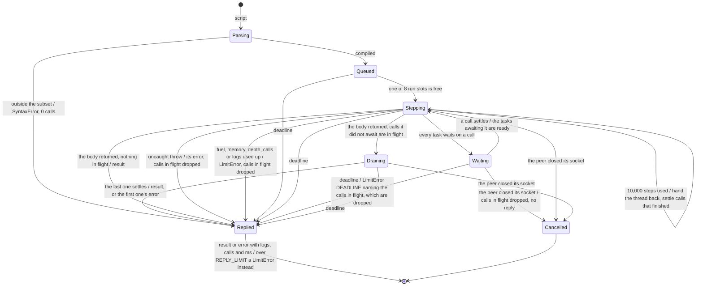
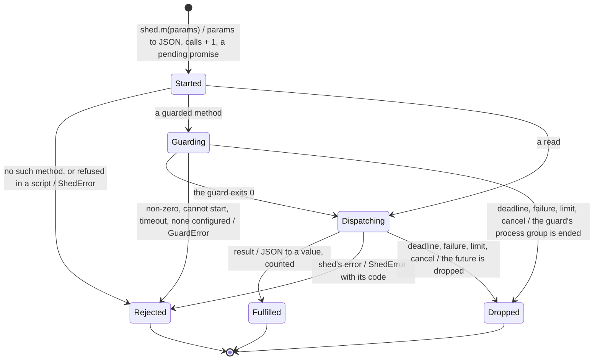

# Script: shed's own code mode (#192)

## Summary

Decision: shed gets a `script` method. A caller sends one program in a JavaScript subset and the server runs it beside the terminals, in a new pure crate that shed builds itself (lexer, parser, compiler, a small virtual machine; no third-party engine, no new dependency). The program calls shed's methods through the same path a socket request takes; a call that acts is first shown to a guard command named in the server's config file, and is refused when there is none. Steps, memory, calls, logs and a deadline bound every run, and a failed run still returns its logs, with the error's line and column.
Slices: (1) parser, +1,700; (2) values and heap, +510; (3) compiler and virtual machine, +1,650; (4) built-ins, +950; (5) promises and the host interface, +400; (6) the server's `script` method and the guard, +460; (7) the command, `--on`, cancelling across machines, the skill doc, +160. About +5,830 lines on 13,215: one cap raise from 13,250 to 19,500 before slice 1.
Open questions: (1) the subset costs about 5,800 lines where a JSON plan costs about 1,400: accept (recommended)? (2) should reading a file from a script need the guard too (recommended: yes)? (3) a caller can only say who it is, shed cannot prove it, so the guard may use it to refuse more, never to allow more: accept (recommended)? (4) one cap raise to 19,500 up front (recommended), or one per slice?

The question, the options with their line estimates, the decision and its consequences are in
[adr.md](adr.md). This file has how it reads, the language, the shapes, the boundaries, the statecharts,
the errors, the guard, the limits, the tests and the slices. [check.mjs](check.mjs) runs the four examples
below against a fixture host and fails when a reply differs from the one shown (`node check.mjs`).

## How it reads

A lane, in one Bash call (the skill doc tells it how):

```console
$ shed script -f blocked.js                  # logs, then the result, then `[3 calls, 2 ms]`
$ shed script - < start.js                   # the program on stdin
$ shed --on box script -f errors.js --json   # runs on box's server; the whole reply as one line
$ shed script -f long.js --timeout 300       # the deadline, 60 s unless raised (at most 600)
```

drover, in place of N calls: one line after `hello`, one line back.

```json
{"jsonrpc":"2.0","id":2,"method":"script","params":{"code":"…","timeout":120,"caller":{"terminal":"orchestrator-7"}}}
```

A program is the body of an async function: `await` and `return` work at the top, and what it returns is
the reply's `result`. The three worked examples, with their replies for check.mjs's fixture:

```js
// blocked.js: every blocked lane of a fleet, with the last 15 lines of each
const lanes = await shed.ls({ labels: { fleet: "shed" } });
const blocked = lanes.filter((t) => t.reported?.state === "blocked");
return Promise.all(
  blocked.map(async (t) => {
    const { text } = await shed.read({ name: t.name, lines: 15 });
    return { name: t.name, kind: t.reported.kind ?? null, note: t.reported.note ?? null, tail: text.split("\n") };
  }),
);
```

```json
{"result":[
  {"name":"impl-190","kind":"permission","note":"Bash: cargo test",
   "tail":["Bash(cargo test --workspace --locked)","Do you want to proceed?","> 1. Yes   2. No"]},
  {"name":"impl-191","kind":"question","note":"Which cap raise?",
   "tail":["The slice needs 180 more lines than the cap has.","Raise the cap, or trim the CLI help?","> "]}],
 "logs":[],"calls":3,"ms":2}
```

Three calls, no guard (all reads); the two reads were in flight together. The fixture's screens are three
lines long, so `lines: 15` returns three.

```js
// start.js: run, send and wait for one lane in one trip
const lane = await shed.run({
  name: "impl-192",
  cwd: "/home/user/work/shed/issue-192",
  cmd: ["claude"],
  labels: { fleet: "shed", issue: "192", role: "impl" },
  idle_after: 5,
});
await shed.wait({ name: lane.name, until: ["idle"], timeout: 20 });
await shed.send({ name: lane.name, text: "Read .brief.md fully, then start." });
const { outcome, terminal } = await shed.wait({ name: lane.name, until: ["done", "blocked", "error"], timeout: 30 });
return { name: lane.name, pid: lane.pid, outcome, state: terminal.reported?.state ?? null, note: terminal.reported?.note ?? null };
```

```json
{"result":{"name":"impl-192","pid":4192,"outcome":"matched","state":"blocked","note":"Bash: git status"},
 "logs":[],"calls":4,"ms":13202}
```

The guard ran twice, before `run` and before `send` (20 ms each in the fixture); both waits count toward
the 60 s deadline.

```js
// errors.js: a filter over read({history: true})
const { text } = await shed.read({ name: "impl-190", history: true });
const lines = text.split("\n");
const kept = lines
  .map((line, i) => ({ n: i + 1, line: line.trim() }))
  .filter(({ line }) => line.matches("^error\\[E\\d+\\]") || line.startsWith("test result: FAILED"));
console.log(`${lines.length} lines read, ${kept.length} kept`);
return kept.slice(-20);
```

```json
{"result":[
  {"n":412,"line":"error[E0308]: mismatched types"},
  {"n":1841,"line":"error[E0599]: no method named `settle` found for struct `Machine`"},
  {"n":2913,"line":"test result: FAILED. 212 passed; 1 failed; 0 ignored"}],
 "logs":["2913 lines read, 3 kept"],"calls":1,"ms":1}
```

2,913 lines stayed in the server; three came back. `matches` takes shed's own pattern (`wait --output`'s),
since the subset has no regex literals.

```js
// refused.js: the guard says no
await shed.kill({ name: "impl-190" });
return "killed";
```

```json
{"error":{"name":"GuardError","message":"kill refused by the guard: lanes are stopped with drover kill",
          "line":2,"column":12,"code":"GUARD_REFUSED","method":"kill"},
 "logs":[],"calls":1,"ms":21}
```

The server, `crates/shed-server/src/script.rs`: the method, then the host the engine calls back.

```rust
pub(crate) async fn answer(registry: &Shared, outer: &Session, p: ScriptParams) -> Result<Value, RpcError> {
    let (started, deadline) = deadline(p.timeout)?;            // INVALID_PARAMS over 600 s
    let guard = Guard::load(&lock(registry).config);           // `[script]`, read once per run
    let host = ScriptHost { registry, outer, guard, caller: p.caller };
    let mut machine = match Program::parse(&p.code) {
        Ok(program) => Machine::new(&program, Limits::default()),
        Err(error) => return reply(Err(error), None, started),  // SyntaxError, 0 calls
    };
    let outcome = tokio::time::timeout_at(deadline, async {
        let _slot = SLOTS.acquire().await;                      // 8 runs at once
        shed_script::run(&mut machine, &host).await
    })
    .await
    .unwrap_or_else(|_| Err(machine.stopped(Limit::Deadline))); // the run and its calls are dropped
    reply(outcome, Some(&machine), started)                     // logs and calls survive a failure
}

impl Host for ScriptHost<'_> {
    fn call(&self, method: &str, params: Value) -> Call<'_> {
        Box::pin(async move {
            if let Some(answer) = self.local(method, &params) { // `methods`, `describe`
                return answer;
            }
            let m = Method::parse(method).ok_or_else(|| no_such(method))?;
            match m.in_script() {                               // an exhaustive match in shed-proto
                Access::Refused => return Err(not_in_script(m)),
                Access::Guarded => self.guard.check(m, &params, self.caller.as_ref()).await?,
                Access::Read => {}
            }
            let mut session = self.outer.inner();               // hello done, the outer read-only marks
            crate::dispatch(self.registry, &mut session, &Request::inner(m, params)).await
        })
    }
}
```

The engine's whole driver, `crates/shed-script/src/lib.rs`. `Machine` is plain data and never blocks; the
only future in the crate is this loop:

```rust
pub async fn run(machine: &mut Machine, host: &impl Host) -> Result<Value, ScriptError> {
    let mut flying = Flying::new(Limits::IN_FLIGHT);
    loop {
        let step = machine.step(SLICE);                    // at most 10,000 steps
        flying.start(machine.calls(), host);               // host.call(method, params), 32 at once
        match step {
            Step::Done(outcome) => return outcome,
            Step::More => flying.settle_ready(machine).await,   // hands the thread back once
            Step::Waiting => {
                let (id, answer) = flying.next().await;    // every task waits on a call
                machine.settle(id, answer);
            }
        }
    }
}
```

## The language

JavaScript, less what a 60-second program driving terminals does not need. Anything outside is a
`SyntaxError` at its line and column that names the construct and what to write instead.

| | in | out, with the error's hint |
|---|---|---|
| bindings | `const`, `let`; destructuring of objects and arrays with defaults and `...rest` | `var` (use `let`) |
| functions | `function`, arrow functions, `async`, default and rest parameters, closures | `function*`, `yield`, `this`, `class`, getters, setters, `new` (only `new Error(m)`) |
| statements | `if`/`else`, `for (const x of xs)`, `for (;;)`, `while`, `break`, `continue`, `return`, `throw`, `try`/`catch`; semicolons optional as in JavaScript | `switch` (use `if`), `do`, `for…in` (use `Object.keys`), `finally`, labels, `with`, `import`, `export` |
| literals | numbers, `'…'` `"…"`, template strings, `true` `false` `null` `undefined`, `[a, ...b]`, `{a, b: 1, [k]: v, ...o}` | regex literals (use `text.matches(pattern)`), `1n`, tagged templates |
| operators | `+ - * / % **`, `=== !== < <= > >=`, `== null` and `!= null`, `&& \|\| ?? !`, `?:`, `?.`, `typeof`, `await`, `= += -= *= /= ??= \|\|= &&=`, `++ --`, spread in calls | `==` and `!=` with anything but `null`, `in`, `instanceof`, `delete`, `void`, the comma and bitwise operators |
| nesting | 200 levels of brackets, blocks and functions | deeper is a `SyntaxError`, so no source can overflow the parser's stack |

The globals are exactly these; any other name is a `ReferenceError` (with a hint for the usual reaches:
`require`, `fetch`, `process`, `setTimeout`, `Date`, `Buffer`, `RegExp`, `globalThis`, `eval`).

| global | what it has |
|---|---|
| `shed` | `shed.<method>(params)` for every shed method by its wire name (`shed.read`, `shed.file.write`, `shed.machine.stats`), `shed.methods()`, `shed.describe(name)`; each returns a promise |
| `console` | `log`, `info`, `warn`, `error`, `debug`: one line of the reply's `logs` each; strings as they are, other values as JSON |
| `JSON` | `parse`, `stringify(value, null, indent)` |
| `Math` | `min max floor ceil round trunc abs sign sqrt pow`; no `random` (the engine has no entropy and no clock) |
| `Promise` | `all`, `allSettled`, `race`, `resolve`, `reject`; on a promise `then`, `catch` |
| `Object`, `Array`, `String`, `Number`, `Boolean`, `Error` | `Object.keys values entries fromEntries assign hasOwn`; `Array.isArray from`; `String(x)`, `String.fromBytes(bytes)`; `Number(x)`, `Number.isInteger isFinite`; `Boolean(x)`; `Error(message)` |
| `parseInt`, `parseFloat`, `isNaN`, `NaN`, `Infinity`, `undefined` | as in JavaScript |

| on | methods |
|---|---|
| a string | `length at charAt slice substring split trim trimStart trimEnd startsWith endsWith includes indexOf lastIndexOf toLowerCase toUpperCase replace replaceAll padStart padEnd repeat concat localeCompare`, and shed's two: `matches(pattern)` (the pattern of `wait --output`: `.`, `[…]`, `\d \w \s`, `* + ?`, `^ $`) and `toBytes()` |
| an array | `length at push pop shift unshift slice concat join includes indexOf lastIndexOf reverse flat entries`, and with a callback `map filter forEach find findIndex some every reduce flatMap sort` |

Where it differs from JavaScript it refuses rather than guesses: no implicit conversion (`"5" * 2`,
`1 < "2"` and `+` between a number and an object are `TypeError`s; `+` joins only when one side is a
string), and `replace` and `replaceAll` take a string, not a regex. Three things differ without an error,
and the skill doc says so: `sort` without a callback orders numbers as numbers; a string is its code
points, so `length` and indexes count those (the same as JavaScript for ASCII); an object or array in a
template string is its JSON.

`exec` and `file.read` return bytes as arrays of numbers, as on the wire: `String.fromBytes(r.stdout)` is
the text, and `text.toBytes()` the way back for `file.write` and `exec`'s `stdin`.

## Values and JSON

```rust
/// One value. `Copy`: everything that can grow lives in the heap, behind a handle.
pub enum Value { Undefined, Null, Bool(bool), Number(f64), Ref(Handle) }

enum Cell {
    Str(Box<str>),
    Array(Vec<Value>),
    Object(Fields),                      // string keys in insertion order; no prototype
    Closure { function: FnId, scope: Handle },
    Scope { parent: Option<Handle>, slots: Vec<Value> },
    Native(Builtin),                     // a built-in, or one bound to its receiver
    HostPath(Box<str>),                  // `shed.file` on its way to `shed.file.read(…)`
    Promise(Settled),                    // pending with its waiters, fulfilled, or rejected
    Task(Frames),                        // one async call: its frames and operand stack
}
```

The heap is an arena of cells with a mark and sweep from the tasks, the globals and the calls in flight.
Every cell is counted (its bytes, 16 per array slot, key bytes plus 16 per field), so "bytes held by live
values" is exact after a sweep and garbage costs nothing. An error is an object: `name`, `message`, `line`,
`column`, and for a shed or guard error `code` and `method`.

| JSON | value | and back (call params, `result`, `JSON.stringify`) |
|---|---|---|
| `null`, `true`, `false`, a string | the same | the same |
| a number | a number (an f64: whole numbers are exact up to 2^53) | an integer when it is whole and within 2^53, so `lines: 15` reaches the server as `15`; else a float |
| an array | an array | the same; an `undefined` element is `null` |
| an object | an object, keys in the order received | the same; an `undefined` field is left out |
| | `NaN`, `Infinity`, a function, a promise, a `shed` path | a `TypeError` naming the path, `result[2].tail is a Promise: await it`. Only `JSON.stringify` follows JavaScript here (`null`, or left out) |

A call's result is counted into the heap as it is converted; a result that does not fit ends the run with
`MEMORY`.

## Data shapes

The wire, `crates/shed-proto/src/script.rs` (a new file: `lib.rs` is 60 lines under the size limit):

```rust
/// `script` params.
pub struct ScriptParams {
    /// The program: the body of an async function, in shed's JavaScript subset; at most 256 KiB.
    pub code: String,
    /// Stop it after this many seconds: 60 unless given, at most 600.
    pub timeout: Option<f64>,
    /// Run it on this machine's server, over its held link.
    pub machine: Option<String>,
    /// Who sends it, as the sender says; the guard gets it unchanged.
    pub caller: Option<Caller>,
}

/// What a script's sender says about itself. shed proves none of it.
pub struct Caller {
    /// The terminal it runs in (`shed script` sends `$SHED`).
    pub terminal: Option<String>,
    /// Its working directory.
    pub cwd: Option<PathBuf>,
}

/// `script` result: `result` when the program returned, `error` when it did not; never both.
pub struct ScriptResult {
    /// What the program returned, as JSON; `null` when it returned nothing.
    pub result: Option<Value>,
    /// Why it stopped.
    pub error: Option<ScriptError>,
    /// One entry per `console` call, in order.
    pub logs: Vec<String>,
    /// How many `shed` calls it made, refused ones included.
    pub calls: u64,
    /// How long it took, queueing and guards included.
    pub ms: u64,
}

/// A script's error: where, and what.
pub struct ScriptError {
    /// `SyntaxError`, `ReferenceError`, `TypeError`, `RangeError`, `Error`, `ShedError`, `GuardError` or `LimitError`.
    pub name: String,
    /// One line.
    pub message: String,
    /// The line, from 1.
    pub line: u32,
    /// The column, from 1, in code points.
    pub column: u32,
    /// A shed error's name (`NO_SUCH_TERMINAL`), a guard's verdict (`GUARD_REFUSED`) or the limit (`FUEL`).
    pub code: Option<String>,
    /// The shed method that failed or was refused.
    pub method: Option<String>,
}

/// How a method may be called inside a script.
pub enum Access { Read, Guarded, Refused }

impl Method {
    /// A `match` with no `_` arm: a new method does not compile until it is classified.
    pub const fn in_script(self) -> Access { … }
}
```

`Method::Script` is the 33rd method. `Pattern` moves from shed-core to `crates/shed-proto/src/pattern.rs`:
its only user is the server's `wait`, its syntax is part of the wire contract, and the engine may use
proto only.

The engine, `shed-script`:

```rust
/// What a script can reach: shed's methods, by wire name. The engine's only way out.
pub trait Host: Sync {
    /// Starts one call. The engine polls it with the others in flight and drops it to cancel.
    fn call(&self, method: &str, params: serde_json::Value) -> Call<'_>;
}
pub type Call<'a> = Pin<Box<dyn Future<Output = Result<serde_json::Value, RpcError>> + Send + 'a>>;

pub struct Program { /* compiled code and constants; no state */ }
impl Program { pub fn parse(code: &str) -> Result<Self, ScriptError>; }

pub struct Machine { /* heap, tasks, logs, counters */ }
impl Machine {
    pub fn new(program: &Program, limits: Limits) -> Self;
    pub fn step(&mut self, steps: u64) -> Step;                 // never blocks, never recurses natively
    pub fn calls(&mut self) -> Vec<(CallId, String, serde_json::Value)>;   // started since the last look
    pub fn settle(&mut self, id: CallId, answer: Result<serde_json::Value, RpcError>);
    pub fn stopped(&self, limit: Limit) -> ScriptError;         // at the main task's position, naming calls in flight
    pub fn logs(&self) -> &[String];
    pub fn calls_made(&self) -> u64;
}
pub enum Step { More, Waiting, Done(Result<serde_json::Value, ScriptError>) }

pub struct Limits { pub fuel: u64, pub memory: usize, pub depth: usize, pub calls: u64, pub logs: usize }
pub enum Limit { Fuel, Memory, Depth, Calls, Logs, Deadline, Reply }
```

The guard's table in the server's config file (`config.toml`, beside `[machines]`):

```toml
[script]
guard = ["drover", "guard"]     # the command; the call arrives on its stdin
guard_timeout = 10              # seconds; 10 unless given
```

## Module boundaries

| module | lines | owns | may use |
|---|---|---|---|
| `shed-script`: `lex.rs` | 430 | tokens with line and column, template strings, the newline rule for semicolons | nothing |
| `ast.rs`, `parse.rs`, `error.rs` | 1,270 | the tree, the subset's edge (every "out" row above is one message here), the nesting limit | `lex` |
| `value.rs`, `heap.rs` | 510 | `Value`, `Cell`, the arena, the mark and sweep, the byte count | nothing |
| `compile.rs` | 860 | tree to instructions: scopes, jumps, handlers, destructuring | `ast`, `value` |
| `vm.rs` | 900 | frames, tasks, promises, the step loop, fuel and depth | `heap`, `compile`, `builtins` |
| `builtins/`, `prelude.js`, `json.rs` | 950 | the tables above; JSON in and out. Methods that take a callback (`map`, `sort`, `then`) are 120 lines of the subset itself, compiled with each program, so no built-in ever calls back into the machine | `heap`, `value`, `shed_proto::Pattern` |
| `lib.rs` | 290 | `Program`, `Machine`, `Limits`, `Host`, `run` | all of the above, `shed_proto::{RpcError, ScriptError}`, `serde_json`, `std::future` |
| `shed-proto`: `script.rs`, `pattern.rs` | 100 | the wire shapes, `Access`, `Method::in_script`; `Pattern`, its 105 lines moved from shed-core | nothing |
| `shed-server`: `script.rs` | 230 | `answer`, `ScriptHost`, the run slots, the deadline, the reply and its size check, `methods` and `describe` from `proto::openrpc()` | `shed_script`, `crate::dispatch`, `script::guard`, `clock` |
| `script/guard.rs` | 85 | `[script]` of the config file, the guard's input, its verdict | `runner::exec`, `toml` |
| `lib.rs`, `links.rs`, `machines.rs`, `runner.rs` | 125 | one `dispatch` arm; the peer-closed watch in `connection`; `script` forwarded on a connection of its own; `[script]` skipped by the machines reader; `exec` ends its group when dropped | as today |
| `shed` (CLI): `script.rs` | 80 | `shed script`, its output and exit code | `shed_server::{Client, proto}` |

- `shed-script` is pure: no socket, file, process, thread, clock, environment or `unsafe`, and no async
  runtime. Its dependencies are `shed-proto` and `serde_json`. The layer rule, eight bans and the
  dependency check that hold this are at the end of [adr.md](adr.md).
- The engine knows no method name. `shed.a.b(p)` is `host.call("a.b", p)`; what exists, what is refused
  and what is guarded is the server's `ScriptHost` and proto's `Access`.
- An inner call is `dispatch`, the function a socket request reaches after its line is parsed, with a
  session of its own. It is polled inside the script's request, never spawned, so the request's save
  generation (`registry::answering`) and its handover count cover it: the reply is written after the state
  file has what the script changed, as for one call.
- Only `script/guard.rs` starts the guard, through `runner::exec`. Only `script.rs` reads time, through
  `clock::tokio_now` and tokio's timeout.

## Statecharts

One run:



One call, from `shed.m(params)` to its promise settling. `Promise.all` over N calls is N of these at once
(32 in flight, the rest queued in order) and one task waiting for all of them, or for the first rejection:



- A call starts when it is called, not when it is awaited, as in JavaScript. A run that returns waits for
  the calls it started and did not await (`Draining`), so a forgotten `await` before `shed.send` still
  sends; if such a call fails, its error is the reply's.
- A dropped call may or may not have taken effect: a `send` half written, an `exec` whose group was just
  ended. The error names the methods that were in flight. What ran before stays done; nothing is rolled
  back.
- The peer closing its whole socket cancels, within a second; a peer that only finished writing does not (drover's remote
  call is `shed connect` with the request on stdin, which closes that side at once). The two are told apart
  in adr.md, "Checked by running".

## Errors

Everything about the program is in the result, as `exec` answers with an exit code: a failed script is
`{error, logs, calls, ms}`, so its logs survive. An RPC error is left for what happens before a run
(`INVALID_PARAMS` for a timeout over 600 or code over 256 KiB, `NO_LINK` for the machine).

| `name` | when | `code` | caught by `catch` |
|---|---|---|---|
| `SyntaxError` | the code is outside the subset; nothing ran | | no |
| `ReferenceError`, `TypeError`, `RangeError` | an unknown name; a wrong type, a property of `null`, a value JSON cannot carry; a bad pattern or count | | yes |
| `Error` | `throw new Error(m)`; any other thrown value, its text as the message | | yes |
| `ShedError` | a shed method failed, or may not be called in a script | shed's own name: `NO_SUCH_TERMINAL`, `INVALID_PARAMS`, `DRAFT_HELD`, …; `NOT_IN_SCRIPT`; `NO_SUCH_METHOD` | yes |
| `GuardError` | the guard did not allow a call | `GUARD_REFUSED`, `GUARD_FAILED` (it could not start), `GUARD_TIMEOUT`, `NO_GUARD` | yes |
| `LimitError` | a limit ended the run | `FUEL`, `MEMORY`, `DEPTH`, `CALLS`, `LOGS`, `DEADLINE`, `REPLY_LIMIT` | no |

`line` and `column` are where it was thrown: for a failed call, the method's name in `shed.kill(`; for
`DEADLINE`, where the main body was waiting; for `REPLY_LIMIT`, its `return`. Messages are written to be
acted on in one more trip:

```text
SyntaxError 3:14: a regex literal is not in the subset: use text.includes(…) or text.matches(pattern)
ReferenceError 1:1: setTimeout is not defined: a script has no timers; shed.wait({…, timeout}) waits
TypeError 7:10: result[1].tail is a Promise: await it (Promise.all for a list)
ShedError 4:22: read: NO_SUCH_TERMINAL: impl-19
GuardError 2:12: kill refused by the guard: lanes are stopped with drover kill
GuardError 2:12: kill refused: this server has no script guard ([script] guard in config.toml)
LimitError 9:3: stopped at the 60 s deadline; in flight: wait, wait
LimitError 12:1: the reply is 9,437,201 bytes, over the limit of 8,388,608: return less
```

## The guard

| | |
|---|---|
| Where | `[script]` in the server's `config.toml`: `guard`, a command line, and `guard_timeout` (10 s). Read once when a run starts, never from the request: a caller cannot name its own guard |
| When | Before each call of a guarded method, every time; nothing is remembered between calls. Calls of one `Promise.all` are guarded at the same time |
| Given | One JSON line on stdin: `{"method":"exec","params":{"cmd":["git","push"],"cwd":"/home/user/project"},"machine":null,"caller":{"terminal":"impl-190","cwd":"/home/user/work/shed/issue-190"}}`. `params` are the call's, untouched; `machine` is where the call will act when it names one (`machine`, or `box/t1`), else `null`; `caller` is the request's |
| Allowed | It exits 0 within the timeout. Its output is ignored |
| Refused | Any other exit: `GUARD_REFUSED`, the reason its stderr's last line (at most 400 characters), else `exit 3`. It cannot start: `GUARD_FAILED`. It runs past the timeout and its process group is ended: `GUARD_TIMEOUT`. No `guard` key: `NO_GUARD` |
| In the script | A `GuardError` thrown at the call, naming the method and the reason; the method was never dispatched |

| class | methods | in a script |
|---|---|---|
| read | `ls`, `get`, `read`, `wait`, `machine.stats`, `machine.links`, `agents`, `agents.match`, `rpc.discover` | called as they are; work with no guard configured |
| guarded | `run`, `send`, `keys`, `kill`, `rm`, `resize`, `state`, `acp.model`, `exec`, `file.write`, `file.read` (open question 2) | the guard first |
| refused | `events`, `attach`, `screen.watch`, `terminal.input`, `terminal.keys`, `terminal.resize`, `terminal.readonly`, `handover`, `handover.check`, `hello`, `heartbeat`, `emit`, `script` | `ShedError` `NOT_IN_SCRIPT`: they stream, belong to a person's keyboard or to the connection, or replace the server |

A script runs under the guard of the server it runs on: with `--on box`, box's `[script]`. A call it
forwards to another machine (`machine`, `box/t1`) is guarded here, with that machine named, and arrives
there as a plain call. `wait` is a read and counts toward the deadline. `shed.methods()` returns `[{name, summary, script}]` with
`script` one of the three classes; `shed.describe(name)` returns that method's entry of the OpenRPC document
with the schemas it refers to, so one call is enough to write a correct one.

## Limits and the reply

| limit | value | counted by | over it |
|---|---|---|---|
| deadline | 60 s; `timeout` raises it to at most 600 | the server, with tokio; it starts when the request is read | `DEADLINE` |
| steps (fuel) | 50,000,000 | the engine: one per instruction; a built-in adds one per element or 64 bytes it touches | `FUEL` |
| live values | 64 MiB | the engine's heap, exact after a sweep; a built-in reserves before it allocates | `MEMORY` |
| call depth | 200 frames in a task | the engine | `DEPTH` |
| calls | 2,000, refused ones included | the engine | `CALLS` |
| calls in flight | 32; more wait their turn | the engine's driver | none |
| logs | 64 KiB | the engine | `LOGS`; the reply has the logs up to it |
| code | 256 KiB | the server | `INVALID_PARAMS` |
| runs at once | 8 per server; more wait inside their deadline | the server | `DEADLINE` |
| reply | `REPLY_LIMIT`, 8 MiB as one line | the server | `REPLY_LIMIT`: an error that says to return less, with the logs; never a cut reply |

The reply is `{result, logs, calls, ms}`, or `{error, logs, calls, ms}`. Only the deadline is the
caller's to set. The engine reads no clock, so the same program with the same answers takes the same
steps on every machine, and the fuel and memory tests are exact.

## The CLI and the skill doc

```console
shed script -f <file> [--timeout <S>]     # the file is the program
shed script - [--timeout <S>]             # stdin is the program
shed --on <machine> script …              # on that machine's server, one round trip
```

Without `--json`: each log line, then the result (a string as it is, anything else as indented JSON) on
stdout, then `[N calls, X ms]` on stderr; exit 0. On an error: the logs, then `error: <name> <line>:<column>:
<message>` on stderr; exit 1. With `--json`: the reply as one line, and the same exit code. It sends
`caller` as `$SHED` and its working directory. With `--on`, the command goes to the local server with
`machine` when that holds the machine's link, which forwards it on a connection of its own (the shared one
would hold every other call to that machine for the script's whole run); else it goes over `ssh … shed
connect`, as `exec` does.

`skill/script/`, laid out as blocks' skill and read by a lane in its brief:

| file | what |
|---|---|
| `SKILL.md` | 60 lines: when a script pays (three or more calls, or a read you need a part of); the form (an async function's body, `return` the answer, `console.log` to trace); `shed.<method>(params)`, `methods`, `describe`; the limits in one table; what is not JavaScript here, as the "out" column; how a refusal and a limit read |
| `methods.md` | generated by `just generate` from the OpenRPC document: each method, its one line, its class. Listed under `generated` in `.drover/arch.toml` |
| `examples/blocked.js`, `start.js`, `errors.js` | the three above. A test in `crates/shed/tests/script.rs` runs each against a real server, so they cannot rot |

## Tests that prove the limits

Engine tests need no runtime and no clock (`crates/shed-script/tests/`, a fake `Host`); server tests drive
the real binary over its socket (`crates/shed/tests/script.rs`).

| test | proves |
|---|---|
| `a_busy_loop_stops_on_fuel` | `while (true) {}` is `FUEL` after exactly 50,000,000 steps, taken in slices, in a test with no runtime and no clock |
| `growing_values_stop_on_memory`, `garbage_is_not_counted` | an array grown without end is `MEMORY` before `FUEL`; a loop that builds and drops 1 GiB of strings finishes |
| `deep_recursion_stops_on_depth`, `deep_nesting_is_a_syntax_error` | `DEPTH` at frame 201; 100,000 nested brackets are a `SyntaxError`, not a stack overflow |
| `a_hung_wait_stops_at_the_deadline` | a `wait` on a terminal that never reports is `DEADLINE` at 60 s of a paused clock, names `wait`, and the wait is gone |
| `closing_the_connection_cancels_the_calls_in_flight`, `a_peer_that_only_stops_writing_gets_its_reply` | after the socket closes, the `exec` the script was waiting on has no process left within 2 s and its marker file never appears; `shed connect` with the request on stdin still prints the reply. Run on Linux and macOS |
| `only_the_listed_globals_exist` | the global table equals the list above; `require`, `process`, `fetch`, `globalThis`, `Date`, `setTimeout`, `eval`, `Function`, `Symbol`, `Reflect`, `Proxy` are each a `ReferenceError` |
| `a_guard_that_exits_non_zero_refuses`, `…_cannot_start_refuses`, `…_times_out_refuses`, `no_guard_refuses_what_acts`, `a_read_needs_no_guard` | each `GuardError` code; the refused `exec` left no process and no event; `ls` and `read` answer on a server with no `[script]` |
| `every_method_has_a_class` | the table in this file equals `Method::in_script` (which also cannot compile without a new method's arm) |
| `the_2001st_call_stops_the_run`, `logs_stop_at_64k`, `a_reply_over_the_limit_is_an_error_not_a_cut` | `CALLS`, `LOGS` with the logs kept, `REPLY_LIMIT` with a reply that parses |
| `promise_all_runs_its_calls_at_the_same_time` | both calls started before either settled; with 40, at most 32 were in flight |
| `an_inner_call_is_a_socket_call` | a `run` from a script emits `started`, is in the state file before the reply is written, and fails with the same `INVALID_PARAMS` text as over the socket |
| `an_unawaited_send_is_sent` | the run drains; its failure is the reply's error |

## Slices

Each is its own issue and PR, in this order; lines are non-test lines under `crates/*/src`, and "cap" is the
total the slice needs. Staging is at 13,215 of 13,250.

| | slice | what | lines | cap |
|---|---|---|---|---|
| 1 | **Parser** | the `shed-script` crate; `lex`, `ast`, `parse`, `error`; every "out" construct's message; the layer, the bans, their fixture and the dependency check | +1,700 | 14,915 |
| 2 | **Values and heap** | `value`, `heap`: cells, the arena, mark and sweep, the byte count | +510 | 15,425 |
| 3 | **Compiler and machine** | `compile`, `vm` without promises, `Program`, `Machine::step`; fuel and depth; closures, destructuring, `try`/`catch` | +1,650 | 17,075 |
| 4 | **Built-ins** | `builtins/`, `prelude.js`, `json`; `Pattern` moves to shed-proto (no net lines); memory reserved before allocating; the globals test | +950 | 18,025 |
| 5 | **Promises and the host** | tasks, `await`, `Promise.*`, `Host`, `run`, the call and in-flight limits, draining | +400 | 18,425 |
| 6 | **The server** | `ScriptParams` and friends, `Access`, `Method::Script`; `script.rs`, `script/guard.rs`, `[script]`; the peer-closed watch; `exec` ends its group on drop; the two protocol docs regenerate | +460 | 18,885 |
| 7 | **The command and the skill** | `shed script`; `script` over a link on its own connection, ended with the run; `shed connect` ends when its reader is gone (rustix's `event` feature, on in shed-core already); `skill/script/` with `methods.md` generated; the examples' test | +160 | 19,045 |

Slices 1 to 5 touch no existing file but `Cargo.toml`, `.drover/arch.toml` and, in 4, the `Pattern` move, so
they conflict with nothing in flight. The estimate is 5,830; the last design's largest slice landed 43%
over its own (#178: 472 for 330), so the raise asked is to **19,500**, once, before slice 1, recorded in
`docs/cap-history/`. drover's side (its guard command, its generated scripts) is drover's issue, after
slice 7.
