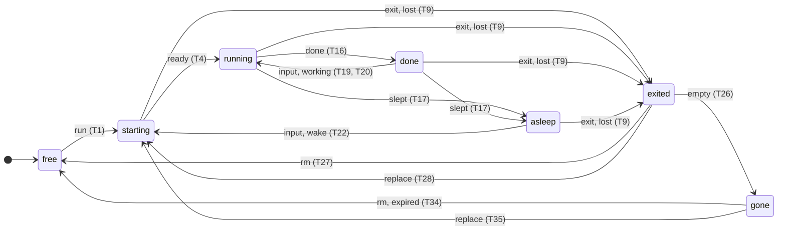
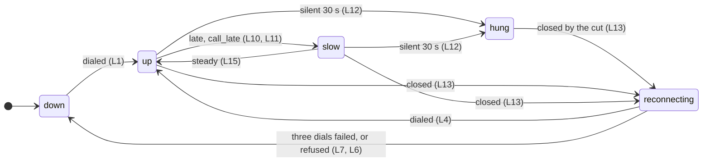
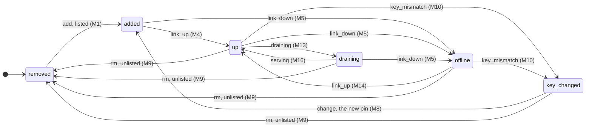
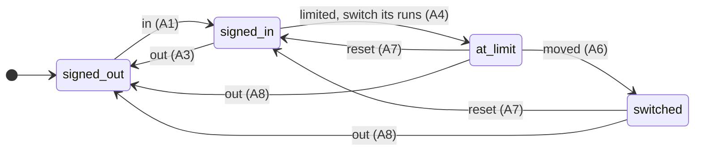
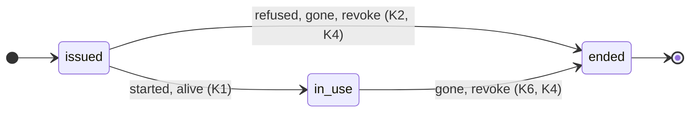

# One transition table drives every shed flow (#309)

## Summary

Decision: every shed flow (a terminal, a link, a machine, an account, a proxy key, and the drain #307 adds) gets its states, its facts and its rows from one data file each, and the build turns the six files into the only code that may change a state. A row says: in this state, on this fact, go there, do this, who owes the next move, by when, and which event goes out when two retries have failed. A missing row stops the build. What the states mean: a finished terminal is "exited" while shed ends what its program left behind and "gone" once nothing of it runs, and its name stays held until it is removed, expires, or a new run takes it over in one call; a machine is offline only when its link is down; a key ends only when the shed on its machine says its run is gone; an account is "switched" when it is at its limit and its runs were moved off it.
Slices: (1) the six tables, the engine and the gap check; (2) the runner and the fact readers in shadow, with the disagreement report; then one flow at a time, each after its own shadow week and each deleting the code it replaces: (3) terminal, (4) link, (5) machine, (6) account, (7) key; (8) the old wire fields go once drover and cooee read the new ones. #307's pinned host key and drain are built on the table from their first day.
Open questions: (1) when a program exits and leaves processes behind, shed ends them (recommended: a server restart already does, and a key cannot end while they run), or leaves them and the terminal stays "exited"? (2) a flow takes over on its report alone, through the normal review (recommended), or on your OK each time? (3) one cap raise of about 700 lines in its own cap issue, sized by `drover cap berth` when filed; about 150 of them come back by slice 8.

The question, the options, the decision, the four root causes with their rows, the consequences and the
`arch.toml` lines: [adr.md](adr.md). The fact list and every flow's full table: [tables.md](tables.md), checked
by [gap.py](gap.py). Types and wire shapes: [shapes.md](shapes.md). This file has how the callers read, the
statecharts, the engine and its boundaries, the gap test, the shadow week and the slices.

Read on shed staging `675ab71`.

## How it reads

### drover, after drover#1567

One field per flow, the same shape everywhere: `flow: { state, since, row, stuck? }`.

```rust
// a lane: one value. drover#1649 maps these to its own lane facts.
let lane = match shed.get(&name) {
    Ok(t) => match t.flow.state {
        Life::Starting | Life::Running => Lane::Running,
        Life::Asleep => Lane::Asleep,                      // wakes on input
        Life::Done => Lane::Done,                          // alive, its turn over: never "live and working"
        Life::Exited => Lane::Exited,                      // ended; shed is clearing what it left
        Life::Gone => Lane::Gone,                          // nothing of it runs: safe to save, replace or remove
        Life::Free => Lane::Free,                          // never listed: a free name answers NO_SUCH_TERMINAL
    },
    Err(e) if e.is(ErrorCode::NoSuchTerminal) => Lane::Free,   // the shed answered: the name is free
    Err(e) => Lane::Unknown(e),                                // no answer is not a fact: nothing ends on it
};

// a host: one call, every machine
for m in shed.machines()? {                                // machine.ls
    match m.flow.state {
        Machine::Up => place_on(&m, m.link.is_some_and(|l| l.flow.state == Link::Slow)),   // slow: works, prefer another
        Machine::Draining => finish_only(&m),              // #307: nothing new, lanes end, work is saved
        Machine::Added | Machine::Offline => hold(&m),     // its lanes stay as they were
        Machine::KeyChanged | Machine::Removed => alert(&m, m.by.as_deref()),
    }
}

// start a lane: the same id twice is one run; an ended holder of the name is replaced in the same call
let run = RunParams { name: Some(name), id: Some(spawn_id), replace: true, machine: Some(host), ..run };
match shed.run(&run) {
    Ok(t) => started(t),
    Err(e) if e.is(ErrorCode::NameTaken) => deliver_to(e.holder()?),   // the holder is alive: the refusal names its state and run id
    Err(e) => retry_later(e),                                           // with the same id: never a second lane
}

// one stream for every flow
for e in shed.events(&EventsParams::default())? {
    match e.kind {
        EventKind::Flow(step) => facts.note(&e.name, step),   // a state changed: flow, from, to, fact, row
        EventKind::Stuck(s) => route(&e.name, s),              // a row gave up after its retries: yours to route
        _ => {}
    }
}
```

### a person

```console
$ shed machine ls
NAME    TARGET        MACHINE      LINK          SINCE  NOTE
box     user@box      up           slow          2m     a call took over 10 s
dev-16  dev@10.0.0.7  draining     up            12m    lanes 2 of 2
dev-12  dev@10.0.0.4  offline      down          3m     ssh: connect timed out; dialing every 60 s
old     user@old      removed      -             3h     by file
$ shed run --name build --replace -- make        # takes the name from an exited or gone `build`
$ shed flow report --since 7d                    # rows fired, facts never seen, stuck, shadow disagreements
```

### inside shed

```rust
// a handler checks the edge, hands over one fact and answers what the row did
pub(super) async fn call(cx: &mut Call<'_>) -> Reply {
    let Target { name } = cx.params()?;
    let step = cx.flows().terminal(&name, terminal::Fact::Rm).await?;   // T12 refuses; T27 and T34 free the name
    json(&step.info)
}

// a reader turns one source into facts and changes nothing
pub(crate) fn observe(reg: &Registry, procs: &[Process]) -> Vec<(RunId, terminal::Fact)> { … }

// the flow's actions: one arm per action in its table, so a new action without code does not compile
pub(crate) async fn act(reg: &Shared, run: &RunId, action: terminal::Action) -> Result<(), RpcError> {
    match action {
        Action::Start => …, Action::Wake => …, Action::Pass => …,
        Action::EndTree => …, Action::Clear => …, Action::Restart => …,
    }
}

// the engine is pure: time comes in as a number, so a test waits for nothing (#310)
let mut t = Tracker::<Terminal>::new(0);
assert_eq!(t.on(Fact::Run, 0).run, Some(Action::Start));        // T1
assert_eq!(t.tick(180).and_then(|s| s.stuck), Some("start-slow")); // the program owed `ready`: no retry
assert_eq!(t.state(), State::Starting);                          // T8: it stays, flagged stuck
```

### a row, as slice 1 commits it

```
| T9 | starting, running, asleep, done | exit, lost | exited | end-tree | shed | 10 | tree-left |
```

"A live terminal whose program ended goes `exited`. shed ends what is left of its tree and owes `empty` within
10 s. It tries twice more. Then one `stuck: tree-left` event goes out and row T33 holds it at `exited`."

## Statecharts

Only the rows that move. [tables.md](tables.md) has the rest: what is refused, ignored or impossible.











The drain flow has two states: `serving` and `draining`, moved by `machine.drain` (D1, D2).

## The engine and where it lives

| piece | where | holds |
|---|---|---|
| the tables | `crates/shed-proto/flows/<flow>.md`, six files | states, facts with their sources, rows: data, not code |
| the build step | `crates/shed-proto/build.rs` with `build/flows.rs` | reads the files, refuses a gap, writes per flow `State`, `Fact`, `Action`, `ROWS` and `row(state, fact)` |
| the engine | `crates/shed-proto/src/flow.rs` | `Row`, `Tracker` (state, clock, tries), `Step`, the wire shape `Flow<S>`. Pure: no clock read, no I/O |
| the runner | `crates/shed-server/src/flows.rs` | every `Tracker`. Takes a fact, steps, runs the action, emits `flow` and `stuck` events, ticks the clocks once a second |
| readers and actions | `crates/shed-server/src/flows/<flow>.rs`, one file a flow | `observe`: one source to facts. `act`: one arm per action |
| the generated chart | `docs/flows.md` | every table and its statechart, written by `just generate` |

It is in shed-proto because the states are wire values: the enum a client matches on and the enum the table
names are one generated type, so they cannot drift, and drover gets them with the tagged client release.
shed-proto's build already turns `methods/*.md` and `errors/*.md` into `Method` and `ErrorCode` the same way.
Where each flow runs: the terminal and drain flows on the shed that owns the terminal; link, machine, account
and key on the main host, which has the machine list, the accounts and the proxy.

Who may call whom:

| module | may | may not |
|---|---|---|
| a method handler | check the edge; give the runner a `call` fact; read a state | change a state; run an action |
| a reader (`observe`) | read its one source: the registry, a link's connections, the list file, the store, the key table | write anything; call an action |
| the runner (`flows.rs`) | step a `Tracker`; call the flow's `act`; emit events; save `Flow<S>` into the subject's record | read a source itself |
| an action (`act`) | call the registry, links, machines, shed-accounts' store and keys | step a `Tracker`; feed a fact |
| `registry`, `links`, `machines`, shed-accounts | keep records; expose what readers read and what actions do | compare or set a flow state |
| shed-core | run and reap processes, as today | know a table |

Two things enforce it. `Tracker`'s fields and the setter of a record's `Flow<S>` are private to their files, so
no other module can write a state. An `arch.toml` ban keeps the name `Tracker` out of every file but the
engine and the runner ([adr.md](adr.md)).

How facts arrive: pushed where the source can push (a call, the reaper's wake, a program's report, a line or
an end on a link), read once a minute where it cannot (the list file, `machine.stats`, the account store, the
process table for `empty`, every 2 s while a terminal is `exited`).

## The gap test

The build step fails, with one line per fault, when a table has:

1. a (state, fact) pair with no row, or with two;
2. a row that moves or acts without an owner, a time and an `or`; a timed row without an `or`;
3. a row that enters a state outside the flow's `rest` list with no time (so nothing can sit in `starting`,
   `exited`, `reconnecting`, `hung`, `added`, `draining` or `at_limit` unwatched);
4. a fact with no source from the closed list, or a state nothing reaches, or a non-resting state with no way out.

So a gap does not compile, in CI and on a laptop alike. Adding a fact to a flow leaves one gap per state until
each has its row; adding a state leaves one per fact. Rows name their states one by one, with no "any", so a
new state is never covered by accident. The `Action` enum is generated too, and each flow's `act` matches it
without a catch-all, so an action with no code does not compile either.

Slice 1 adds three tests in shed-proto, run by the `local/test` gate: the six shipped tables build with no
fault; a fixture table with one row removed fails with `gap: (exited, empty) has no row`; a fixture with a
state-entering row and no time fails. [gap.py](gap.py) is the same check on [tables.md](tables.md), so this
ADR's tables were checked before any code.

A fact no reader produces cannot be seen by the build. The report shows it: `never seen` lists every fact with
no observation, and a flow does not take over with one unless a named test of #308's gate produces it.

## The shadow week

Slice 2 ships the runner with every flow in `shadow`: readers feed facts, trackers step, no action runs, and
handlers still call today's code. After every step, and once a minute, the runner asks today's code what it
shows for the same subject and compares.

| flow | today's code shows | counts as agreeing with |
|---|---|---|
| terminal | `state` and `reported`: running; running + `done`; running + `hibernated`; exited; no entry | starting or running; done; asleep; exited or gone; free |
| link | `LinkState`: up; reconnecting; down | up or slow; hung or reconnecting; down |
| machine | a line in the file with a held link; no line | every state but removed; removed |
| account | `AccountState`: ready; signed-out or drifted; limited | signed_in; signed_out; at_limit or switched |
| key | `KeyState`: live; ended or revoked | issued or in_use; ended |

Two kinds of line are written. `state`: the two differ for more than 2 s. `action`: today's code did something
the table's row at that moment does not (it ended a key, marked a link down, switched an account), or the
table's row would have acted and the code did not (it would have cut a silent link, ended a left-over tree).

Where: `flow-shadow.jsonl` beside the state file of each shed (0600; at 10 MB the older half is dropped), one
JSON object a line ([shapes.md](shapes.md)). Read back with `shed flow report --since 7d [--json]`, and
`--on <machine>` for the others. `shed doctor` gets one row: the lines of the last 24 h.

What ends it, per flow:

1. Seven days in a row on one build, on the main host and every machine it lists, with no unexplained line for
   that flow. A line is explained in the flow's take-over issue, by class: either the row was wrong (the row is
   fixed, and that flow's seven days start again) or the code was wrong (the line names the symptom it
   reproduces, and the row stands). The `action` lines of the key flow are the expected proof of root cause 3.
2. No fact `never seen`, or each one produced by a named test of #308's gate.
3. The flow's take-over slice then merges through the normal gates, with the report in its PR body. It sets
   that flow to `drive` (a constant in the runner, not a setting), deletes today's code for it and deletes its
   comparison. Going back is a revert.

Rows with no code today have nothing to disagree with: the drain flow, `draining` and `key_changed`, `replace`
and run ids. They drive from the day they merge and are covered by tests.

## Slices

Each is one issue. `src/` lines are estimates.

| | slice | adds | deletes | net |
|---|---|---|---|---|
| 1 | the tables, the build step, the engine, the three gap tests, `docs/flows.md` | `flows/*.md`, `flow.rs` | nothing: it replaces no code yet | +180 |
| 2 | the runner, the readers, shadow and its report: `flow.report`, `shed flow report`, the doctor row | `flows.rs`, `flows/*.rs` | nothing; its comparisons are deleted by 3 to 7, `flows/shadow.rs` by 8 | +510 |
| 3 | terminal takes over: `id` and `flow` on a terminal, `run`'s `id` and `replace`, `NAME_TAKEN` naming the holder, `flow` and `stuck` events, left-over trees ended, `machine.stats` counting by state | `flows/terminal.rs`'s `act` | `registry/exit.rs`'s `refresh` exit half, `exited`, `mark_kill`, `killed`; `load.rs`'s lost branch and `end_left_over`; `prune`; `counts`; the 38 lines that compare `State::Running` or `State::Exited` read the flow | -10 |
| 4 | link takes over: the 15 s dial, call deadlines, `slow`, `hung` and the cut, a fresh calls connection | `flows/link.rs`'s `act` | `links.rs`'s `hold` state handling and `Held::set`; `machines::backoff`; `machines::stats`, `Offline`, `STATS_TIMEOUT` and the `seen/` folder: the second up-or-down fact | -40 |
| 5 | machine takes over: `machine.ls`, the server as the list's one writer, `removed` kept 24 h with who, file and links compared each minute | `flows/machine.rs`'s `act` | `Links::sync` and its 4 calls; the CLI's own writes of the list in `cmd/machine.rs` | +70 |
| 6 | account takes over | `flows/account.rs`'s `act` | the state `match` in `Store::account`; `choice::usable`'s; `proxy.rs`'s `rate-limited` branch and `switch`, which becomes the action | -30 |
| 7 | key takes over (after 3 and 4): keys bound to run ids, `find` | `flows/key.rs`'s `act` | `proxy::sweep`, `proxy::removed`, `watch`'s exit branch, `run_on`'s revoke on any error, `Keys::end` and `Keys::name` by terminal name, `dispatch.rs`'s `rm` special case | -15 |
| 8 | the old wire goes, after drover (drover#1567's adoption) and cooee read `flow`: `TerminalInfo.state`, `Link.state` and `since`, `machine.links`, the old `AccountState` and `KeyState`; `flows/shadow.rs` | - | all of those | -120 |

Order: 1, 2, then the shadow week; 3 and 4 in either order; 5 after 4; 6 any time after the week; 7 after 3
and 4; 8 last. #307's slices 1 (pinned key: `refused`, `key_mismatch`, `change`, rows M8 and M10) and 2 (the
drain flow, rows M13 and M16 to M18) need only slices 1 and 2 here, and add their readers and actions straight
in `drive`. Each take-over that adds wire fields raises `PROTOCOL` once; slice 8 raises it for the drops.

#308's fault gate runs first and stays the proof: its tests per symptom fail on today's code and must pass at
the take-over of the flow that fixes them (terminal: slice 3; up or down: 4; the list: 5; keys: 7).
