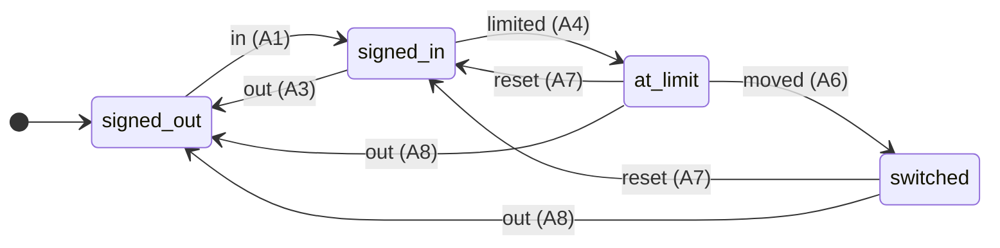
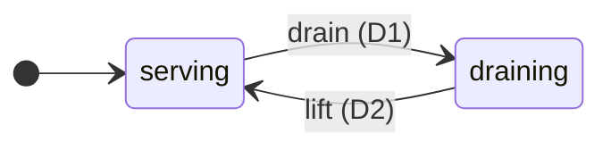

# Flows

<!-- Generated from crates/shed-proto/flows/ by `just generate`; do not edit. -->

Every shed flow's table, then its statechart: the rows that move. How to read a row: [docs/architecture/state-table/tables.md](architecture/state-table/tables.md).

## account

subject: one account of one provider, on the main host
states: signed_out signed_in at_limit switched
start: signed_out
rest: signed_out signed_in switched

| fact | source | read as |
|---|---|---|
| in | store | the last status check says signed in, or it holds a token the provider has not rejected |
| out | store | neither; or its keychain item and its file hold different logins |
| limited | store | it has a limit that ends in the future |
| reset | store | it has no limit, or the limit's end has passed |
| moved | runs | no `auto` run is on it |
| gave_up | clock | the row's time ran out |

| id | state | fact | next | do | owner | within | or |
|---|---|---|---|---|---|---|---|
| A1 | signed_out | in | signed_in | - | shed | rest | - |
| A2 | signed_out | out, limited, reset, moved | = | - | = | = | = |
| A3 | signed_in | out | signed_out | - | caller | rest | - |
| A4 | signed_in | limited | at_limit | switch | shed | 30 | no-switch |
| A5 | signed_in | in, reset, moved | = | - | = | = | = |
| A6 | at_limit | moved | switched | - | shed | rest | - |
| A7 | at_limit, switched | reset | signed_in | - | shed | rest | - |
| A8 | at_limit, switched | out | signed_out | - | caller | rest | - |
| A9 | at_limit | in, limited | = | - | = | = | = |
| A10 | at_limit | gave_up | = | - | caller | rest | - |
| A11 | switched | in, limited, moved | = | - | = | = | = |
| A12 | signed_out, signed_in, switched | gave_up | = | never | = | = | = |

Action: `switch` moves each `auto` run on it to the account `auto` would pick now and tells the run to go on.
A run started on it by name is not moved, as today. `no-switch` means every account of that agent is at its
limit.

Whatever sees a limit (a lane's `rate-limited` report, a usage reading) writes it to the store. The flow reads
the store only.

## drain

subject: this shed itself (#307, slice 2)
states: serving draining
start: serving
rest: serving draining

| fact | source | read as |
|---|---|---|
| drain | call | `machine.drain` |
| lift | call | `machine.drain` with `on: false` |
| gave_up | clock | the row's time ran out |

| id | state | fact | next | do | owner | within | or |
|---|---|---|---|---|---|---|---|
| D1 | serving | drain | draining | end-spares | caller | rest | - |
| D2 | draining | lift | serving | - | caller | rest | - |
| D3 | serving | lift | = | - | = | = | = |
| D4 | draining | drain | = | - | = | = | = |
| D5 | serving, draining | gave_up | = | never | = | = | = |

Action: `end-spares` ends the warm spares. While `draining`, the edge refuses `run` with `DRAINING`, under the
lock that creates a terminal.

## key

subject: one proxy key, on the main host
states: issued in_use ended
start: issued
rest: issued in_use ended

| fact | source | read as |
|---|---|---|
| started | there | its `run` answered with a terminal |
| refused | there | its `run` answered with an error |
| alive | there | the shed there lists its run, in a state other than `gone` |
| gone | there | the shed there answered, and its run is `gone` or not listed |
| unknown | there | no answer about it: the call failed after it was sent, the link is not up, or the machine is removed |
| revoke | call | `proxy.revoke` |
| gave_up | clock | the row's time ran out |

| id | state | fact | next | do | owner | within | or |
|---|---|---|---|---|---|---|---|
| K1 | issued | started, alive | in_use | - | shed | rest | - |
| K2 | issued | refused, gone | ended | - | caller | rest | - |
| K3 | issued | unknown | = | find | shed | 60 | key-unknown |
| K4 | issued, in_use | revoke | ended | - | caller | rest | - |
| K5 | issued | gave_up | = | - | caller | rest | - |
| K6 | in_use | gone | ended | - | caller | rest | - |
| K7 | in_use | started, alive, unknown | = | - | = | = | = |
| K8 | in_use | refused, gave_up | = | never | = | = | = |
| K9 | ended | started, refused, alive, gone, unknown, revoke | = | - | = | = | = |
| K10 | ended | gave_up | = | never | = | = | = |

Action: `find` asks the shed there for the key's run id once its link is up.

A key signs while `issued` and `in_use`. While its `run` call is in flight nothing but that call's answer
speaks for the key; the listing read at link-up speaks for it only afterwards. Every fact is matched by run id,
never by name. So K6 and K4 are the only ways a key in use ends.

```mermaid
stateDiagram-v2
    direction LR
    [*] --> issued
    issued --> in_use: started, alive (K1)
    issued --> ended: refused, gone (K2); revoke (K4)
    in_use --> ended: revoke (K4); gone (K6)
```

## link

subject: the held link to one machine, on the main host
states: down reconnecting up slow hung
start: down
rest: down up slow

| fact | source | read as |
|---|---|---|
| dialed | ssh | a dial got the hello of the shed there, within 15 s |
| dial_failed | ssh | a dial's ssh exited, or 15 s passed with no hello (the ssh child is killed) |
| refused | ssh | a dial was refused for good: another protocol there, or a host key that is not the pinned one |
| beat | ssh | a server heartbeat arrived within 20 s of the last line |
| steady | ssh | four `beat`s in a row with no `late` or `call_late` between |
| late | ssh | a line arrived, more than 20 s after the last |
| call_late | ssh | a call got no answer within its deadline: 10 s, plus the call's own `timeout` for `wait`, `exec` and `script` |
| silent | ssh | nothing arrived for 30 s |
| closed | ssh | a connection ended or the ssh child exited |
| gave_up | clock | the row's time ran out |

| id | state | fact | next | do | owner | within | or |
|---|---|---|---|---|---|---|---|
| L1 | down | dialed | up | learn | shed | rest | - |
| L2 | down | dial_failed, refused | = | dial | shed | every 60 | - |
| L3 | down | beat, steady, late, call_late, silent, closed, gave_up | = | never | = | = | = |
| L4 | reconnecting | dialed | up | learn | shed | rest | - |
| L5 | reconnecting | dial_failed | = | - | = | = | = |
| L6 | reconnecting | refused | down | dial | shed | every 60 | - |
| L7 | reconnecting | gave_up | down | dial | shed | every 60 | - |
| L8 | reconnecting | beat, steady, late, call_late, silent, closed | = | - | = | = | = |
| L9 | up | beat, steady | = | - | = | = | = |
| L10 | up | late | slow | - | shed | rest | - |
| L11 | up, slow | call_late | slow | fresh | shed | rest | - |
| L12 | up, slow | silent | hung | cut | shed | 5 | cut-stuck |
| L13 | up, slow, hung | closed | reconnecting | dial | shed | 20 | link-down |
| L14 | up, slow, hung | dialed, dial_failed, refused | = | never | = | = | = |
| L15 | slow | steady | up | - | shed | rest | - |
| L16 | slow | beat, late | = | - | = | = | = |
| L17 | hung | beat, steady, late, call_late, silent | = | - | = | = | = |
| L18 | hung | gave_up | reconnecting | dial | shed | 20 | link-down |
| L19 | up, slow | gave_up | = | never | = | = | = |

Actions: `dial` runs one `ssh … shed connect`, cut off at 15 s. `learn` reads the machine's facts, starts the
proxy forward and reads its terminal list for the key flow. `fresh` drops the calls connection the late call
sat on and opens another, so no later call waits behind it. `cut` kills the ssh child and shuts both
connections: every call waiting on the link returns `NO_LINK` at once.

```mermaid
stateDiagram-v2
    direction LR
    [*] --> down
    down --> up: dialed (L1)
    reconnecting --> up: dialed (L4)
    reconnecting --> down: refused (L6); gave_up (L7)
    up --> slow: late (L10); call_late (L11)
    up --> hung: silent (L12)
    slow --> hung: silent (L12)
    up --> reconnecting: closed (L13)
    slow --> reconnecting: closed (L13)
    hung --> reconnecting: closed (L13); gave_up (L18)
    slow --> up: steady (L15)
```

A call for a machine whose link is not `up` or `slow` is answered at once: `NO_LINK: <machine>: link <state>
since <time>`. It never waits for a link.

## machine

subject: a machine name in the main host's list
states: removed added up offline draining key_changed
start: removed
rest: removed up offline key_changed

| fact | source | read as |
|---|---|---|
| add | call | `machine.add` with the line it already has, or a new name |
| change | call | `machine.add` whose target, port, key or identity differs from its line |
| rm | call | `machine.rm` |
| listed | list | the file has its line |
| unlisted | list | the file has no line for it |
| link_up | link | its link is `up` or `slow` |
| link_down | link | its link is `down` |
| key_mismatch | link | its link was `refused` over the host key |
| draining | stats | the shed there says it is draining |
| serving | stats | the shed there says it is not |
| gave_up | clock | the row's time ran out |

| id | state | fact | next | do | owner | within | or |
|---|---|---|---|---|---|---|---|
| M1 | removed | add, change, listed | added | link | shed | 120 | never-up |
| M2 | removed | rm, unlisted | = | - | = | = | = |
| M3 | removed | link_up, link_down, key_mismatch, draining, serving, gave_up | = | never | = | = | = |
| M4 | added | link_up | up | - | shed | rest | - |
| M5 | added, up, draining | link_down | offline | - | shed | rest | - |
| M6 | added | gave_up | offline | - | shed | rest | - |
| M7 | added, up, offline, draining, key_changed | add, listed | = | - | = | = | = |
| M8 | added, up, offline, draining, key_changed | change | added | relink | shed | 120 | never-up |
| M9 | added, up, offline, draining, key_changed | rm, unlisted | removed | unlink | caller | rest | - |
| M10 | added, up, offline, draining | key_mismatch | key_changed | hold | caller | rest | - |
| M11 | added | draining, serving | = | - | = | = | = |
| M12 | up | link_up, serving | = | - | = | = | = |
| M13 | up | draining | draining | - | caller | 3600 | drain-slow |
| M14 | offline | link_up | up | - | shed | rest | - |
| M15 | offline | link_down, draining, serving | = | - | = | = | = |
| M16 | draining | serving | up | - | shed | rest | - |
| M17 | draining | link_up, draining | = | - | = | = | = |
| M18 | draining | gave_up | = | - | caller | rest | - |
| M19 | key_changed | link_up, link_down, key_mismatch, draining, serving | = | - | = | = | = |
| M20 | up, offline, key_changed | gave_up | = | never | = | = | = |

Actions: `link` writes its line if the file lacks it and starts its link. `relink` replaces its line and starts
the link again. `unlink` drops its line and its link and records who asked (`by: file` for a hand edit). `hold`
stops dialing and keeps its line.

`removed` is also where a name starts. A removed machine is listed for 24 h with when and by whom. While a
link reconnects, the machine stays `up`: only `link_down` makes it `offline`.

```mermaid
stateDiagram-v2
    direction LR
    [*] --> removed
    removed --> added: add, change, listed (M1)
    added --> up: link_up (M4)
    added --> offline: link_down (M5); gave_up (M6)
    up --> offline: link_down (M5)
    draining --> offline: link_down (M5)
    up --> added: change (M8)
    offline --> added: change (M8)
    draining --> added: change (M8)
    key_changed --> added: change (M8)
    added --> removed: rm, unlisted (M9)
    up --> removed: rm, unlisted (M9)
    offline --> removed: rm, unlisted (M9)
    draining --> removed: rm, unlisted (M9)
    key_changed --> removed: rm, unlisted (M9)
    added --> key_changed: key_mismatch (M10)
    up --> key_changed: key_mismatch (M10)
    offline --> key_changed: key_mismatch (M10)
    draining --> key_changed: key_mismatch (M10)
    up --> draining: draining (M13)
    offline --> up: link_up (M14)
    draining --> up: serving (M16)
```

## terminal

subject: a terminal name on one shed; each run of it has an id
states: free starting running asleep done exited gone
start: free
rest: free running asleep done gone

| fact | source | read as |
|---|---|---|
| run | call | `run` names it |
| replace | call | `run` names it, with `replace` |
| input | call | `send`, `keys` or a prompt for it |
| kill | call | `kill` |
| rm | call | `rm` |
| exit | process | the reaper has its exit status |
| lost | process | no status and no such process: a restart or a reboot took it |
| empty | process | nothing is left of its process tree |
| ready | program | it is up: a plain program started, an ACP bridge has its session |
| working | program | it reported a state other than `done` or `hibernated` |
| done | program | it reported `done` |
| slept | program | the bridge reported `hibernated`: the agent is stopped, the session kept |
| expired | record | it ended more than `SHED_PRUNE_AFTER` ago (24 h) |
| gave_up | clock | the row's time ran out |

| id | state | fact | next | do | owner | within | or |
|---|---|---|---|---|---|---|---|
| T1 | free | run, replace | starting | start | program | 180 | start-slow |
| T2 | free | input, kill, rm | = | refuse NO_SUCH_TERMINAL | = | = | = |
| T3 | free | exit, lost, empty, ready, working, done, slept, expired, gave_up | = | never | = | = | = |
| T4 | starting | ready, working | running | - | program | rest | - |
| T5 | starting | done | done | - | caller | rest | - |
| T6 | starting | slept | asleep | - | caller | rest | - |
| T7 | starting | input | = | pass | = | = | = |
| T8 | starting | gave_up | = | - | caller | rest | - |
| T9 | starting, running, asleep, done | exit, lost | exited | end-tree | shed | 10 | tree-left |
| T10 | starting, running, asleep, done | kill | = | end-tree | shed | 10 | kill-stuck |
| T11 | starting, running, asleep, done | run, replace | = | refuse NAME_TAKEN | = | = | = |
| T12 | starting, running, asleep, done | rm | = | refuse STILL_RUNNING | = | = | = |
| T13 | starting, running, asleep, done | empty, expired | = | never | = | = | = |
| T14 | running | input | = | pass | = | = | = |
| T15 | running | ready, working | = | - | = | = | = |
| T16 | running | done | done | - | caller | rest | - |
| T17 | running, done | slept | asleep | - | caller | rest | - |
| T18 | running, asleep, done | gave_up | = | - | caller | rest | - |
| T19 | done | input | running | pass | program | rest | - |
| T20 | done | working | running | - | program | rest | - |
| T21 | done | ready, done | = | - | = | = | = |
| T22 | asleep | input | starting | wake | program | 180 | start-slow |
| T23 | asleep | ready, working | running | - | program | rest | - |
| T24 | asleep | done | done | - | caller | rest | - |
| T25 | asleep | slept | = | - | = | = | = |
| T26 | exited | empty | gone | - | caller | rest | - |
| T27 | exited | rm | free | clear | caller | rest | - |
| T28 | exited | replace | starting | restart | program | 180 | start-slow |
| T29 | exited | run | = | refuse NAME_TAKEN | = | = | = |
| T30 | exited | input | = | refuse NO_SUCH_TERMINAL | = | = | = |
| T31 | exited | kill, ready, working, done, slept, expired | = | - | = | = | = |
| T32 | exited | exit, lost | = | never | = | = | = |
| T33 | exited | gave_up | = | - | caller | rest | - |
| T34 | gone | rm, expired | free | clear | caller | rest | - |
| T35 | gone | replace | starting | restart | program | 180 | start-slow |
| T36 | gone | run | = | refuse NAME_TAKEN | = | = | = |
| T37 | gone | input | = | refuse NO_SUCH_TERMINAL | = | = | = |
| T38 | gone | kill, empty, ready, working, done, slept | = | - | = | = | = |
| T39 | gone | exit, lost | = | never | = | = | = |
| T40 | gone | gave_up | = | never | = | = | = |

Actions: `start` makes the run's id and starts its process. `wake` starts the agent again on its session and
hands it the input. `pass` hands the input to the program. `end-tree` ends what is left of the process tree
(SIGTERM, SIGKILL 2 s later) and child terminals that do not outlive it. `clear` ends what is left at once and
drops the record, its history and its ACP session. `restart` is `clear`, then `start`.

What each state means to a caller:

| state | a process | output readable | name | takes input |
|---|---|---|---|---|
| free | - | - | free | - |
| starting | starting or waking | yes | held | held until ready |
| running | alive; `reported` says working, idle, blocked… | yes | held | yes |
| asleep | the agent stopped by shed, its session kept | yes | held | yes: it wakes |
| done | alive, its turn over | yes | held | yes: a new turn |
| exited | the program ended, exit status known; shed is ending what it left | yes | held | no |
| gone | none: the process table shows nothing of it | yes | held | no |

A terminal lost in a restart goes `exited` (no status) and then `gone` like any other. A `keep` terminal is
`replace`d by the server itself at load, as a shell.

```mermaid
stateDiagram-v2
    direction LR
    [*] --> free
    free --> starting: run, replace (T1)
    starting --> running: ready, working (T4)
    starting --> done: done (T5)
    starting --> asleep: slept (T6)
    starting --> exited: exit, lost (T9)
    running --> exited: exit, lost (T9)
    asleep --> exited: exit, lost (T9)
    done --> exited: exit, lost (T9)
    running --> done: done (T16)
    running --> asleep: slept (T17)
    done --> asleep: slept (T17)
    done --> running: input (T19); working (T20)
    asleep --> starting: input (T22)
    asleep --> running: ready, working (T23)
    asleep --> done: done (T24)
    exited --> gone: empty (T26)
    exited --> free: rm (T27)
    exited --> starting: replace (T28)
    gone --> free: rm, expired (T34)
    gone --> starting: replace (T35)
```

